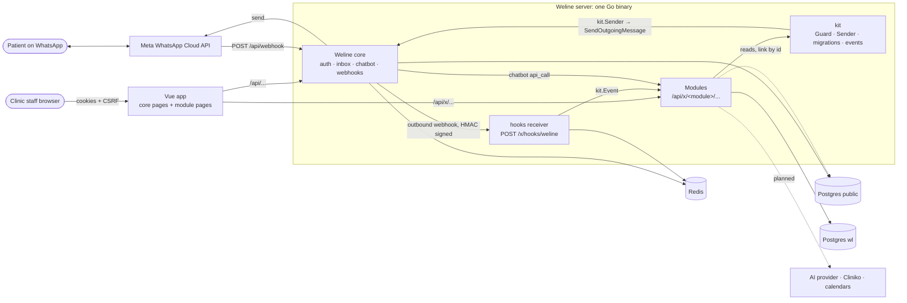
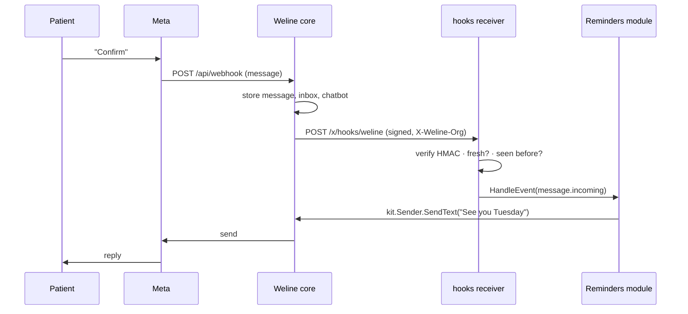

# Weline architecture

How Weline modules sit inside the Weline (whatomate fork) app, how they hear about WhatsApp traffic, and how
the whole thing is built and deployed. Process and rules: [`sdlc/weline-module-sdlc.md`](sdlc/weline-module-sdlc.md)
and [`../CLAUDE.md`](../CLAUDE.md). Data: [`data-model.md`](data-model.md). Security:
[`threat-model.md`](threat-model.md). Decisions: [`adr/`](adr/README.md).

## Components

| Component | What it is | Where |
| --- | --- | --- |
| **Weline core** | Upstream whatomate: auth, organizations, roles, contacts, inbox, templates, campaigns, chatbot flows, outbound webhooks, WhatsApp client. Kept as close to upstream as possible. | `cmd/`, `internal/` (except `internal/modules/`), `frontend/src/` (except `frontend/src/modules/`) |
| **Modules** | Clinic features (practice, booking, calendar, reminders, AI, connectors, CRM), each a Go package + a Vue folder. Today: `example` (template). | `internal/modules/<module>/`, `frontend/src/modules/<module>/` |
| **Module kit** | Shared module plumbing: module contract, migration runner, permission seeder, `kit.Guard`, typed errors, `kit.Sender`, events. | `internal/modules/kit/` |
| **Registry** | Lists module factories; mounts routes, runs migrations, wires event handlers. | `internal/modules/registry.go`, `frontend/src/modules/index.ts` |
| **Hooks receiver** | Receives Weline's own outbound webhooks and dispatches events to modules. | `internal/modules/hooks/` |
| **Postgres, `public` schema** | Upstream tables (organizations, users, contacts, messages, whatsapp_accounts, webhooks, permissions…). Modules read them and link to them by id, never alter them. | upstream migrations (`internal/database`) |
| **Postgres, `wl` schema** | Every module table (`wl.<module>_<thing>`) and `wl.schema_migrations`. | module `migrations.go` |
| **Redis** | Upstream cache, job queue and worker; module de-duplication keys (`wl:hooks:seen:*`). | `internal/queue`, `internal/worker` |
| **Meta WhatsApp Cloud API** | Sends and receives WhatsApp messages. Weline core is the only caller; modules send through `kit.Sender`. | `pkg/whatsapp` |
| **External services** (planned) | AI provider behind `kit.LLM` (Phase 3), Cliniko and calendars behind `Connector` (Phase 4). | future modules |

## Diagram



## The five seams

Modules touch upstream code only at these lines, each marked `// Weline hook`; CI's seam guard
(`.github/scripts/weline-seam-guard.sh`) fails any other upstream change.

| # | Upstream file | Seam line | Effect |
| --- | --- | --- | --- |
| 1 | `cmd/whatomate/main.go` (`setupRoutes`) | `modules.Register(g, app, cfg)` | Mounts module routes and the hooks receiver |
| 2 | `cmd/whatomate/main.go` (inside `if *migrate {}`) | `modules.MustMigrate(db, lo)` | Creates `wl`, runs module migrations, seeds permissions |
| 3 | `frontend/src/router/index.ts` | `...moduleRoutes` | Module pages inside the authenticated layout |
| 4 | `frontend/src/components/layout/AppLayout.vue` | `.concat(moduleNav)` | Module sidebar sections |
| 5 | `frontend/src/i18n/index.ts` | `mergeModuleMessages(i18n)` | Module strings as `wl.<module>.*` |

Pre-SDLC exceptions (legacy booking prototype hooks, rebrand, CI tweaks) are listed with reasons in
`.github/weline/upstream-allowlist.txt` and `seam-exceptions.txt`.

## Event flow

Modules learn about traffic in three ways, and act through one:

1. **Weline webhooks → modules.** Each organization has a managed outbound webhook ("Weline modules
   (managed, do not edit)") created by `hooks.Setup` when `WELINE_PUBLIC_URL` is set. Weline signs each
   delivery (`X-Webhook-Signature`, HMAC-SHA256 with that webhook's secret) and adds `X-Weline-Org`. The
   receiver at `POST /x/hooks/weline` verifies the signature with that org's secret, rejects stale
   deliveries, de-duplicates in Redis, and calls every module implementing `kit.EventHandler` for
   `message.incoming|outgoing`, `contact.created`, `transfer.*`. It is outside `/api` because upstream's
   auth middleware rejects every unauthenticated `/api` request. Weline's SSRF guard blocks private
   addresses, so the URL must be public (a tunnel in local development).
2. **Chatbot `api_call` nodes → module endpoints.** A chatbot flow calls e.g. `GET /api/x/booking/slots`
   through Weline's SSRF-safe HTTP client, with headers from the flow config (an API key for `/api`).
3. **Staff → module pages.** The Vue module pages call `/api/x/<module>/...` with Weline's API client;
   each route is wrapped in `kit.Guard` (login + `wl_` permission in the active organization).

**Sending:** modules call `kit.Sender.SendText/SendTemplate(ctx, orgID, contactID, …)`, which resolves
the contact and WhatsApp account within the org and calls core's `App.SendOutgoingMessage`. The
message is stored, shown in the inbox and fires Weline's own webhooks like any other send.



## Deployment

One binary serves the API, the module routes and the embedded Vue build.

```bash
make build-prod                 # Vue build (incl. frontend/src/modules) embedded into ./whatomate
./whatomate server -migrate     # upstream migrations, then modules.MustMigrate (wl schema, module
                                # migrations, permissions), then serve
```

- Run with `-migrate` once per release, then restart without it. Module migrations are recorded in
  `wl.schema_migrations` and serialised with a Postgres advisory lock, so concurrent starts are safe.
- `dev` deploys to Render (`render.yaml`: Docker web service, Render Postgres, Render Key Value). Settings
  come from `WHATOMATE_<SECTION>__<KEY>` env vars plus `WELINE_PUBLIC_URL`.
- CI (`.github/workflows/weline-ci.yml` + upstream `test.yml`) runs on every PR into `dev`/`production`:
  Go lint and tests, seam guard, frontend checks, migration smoke test on an empty database.
