# Weline data model

What modules store, and what they rely on in Weline's own tables. Architecture:
[`architecture.md`](architecture.md). Security: [`threat-model.md`](threat-model.md).

## Rules for module data (`wl` schema)

- Every module table lives in the Postgres schema `wl`, named `wl.<module>_<thing>`, created by a
  versioned `kit.Migration` (never `AutoMigrate`), recorded in `wl.schema_migrations` as `<module>/<id>`.
- Migrations are additive and have a working `Down`. Never edit a released migration; add a new one.
- Every table has `organization_id uuid NOT NULL`, indexed (usually with the column you sort by), and every
  query filters on it. Services take `orgID` as their first argument.
- Never add columns to upstream tables, and don't put foreign-key constraints into upstream tables either:
  link by id (`contact_id`, `user_id`, `whatsapp_account_id`) and check org ownership in the service.
- Times are `timestamptz` in UTC. Each practice has an IANA time zone (default `Australia/Sydney`) for display
  and slot maths.
- External ids from connectors go in `wl.connector_links (entity, local_id, provider, remote_id)`, never as
  columns on other tables.
- Secrets (connector keys, AI keys) are encrypted with Weline's `crypto.EncryptFields` and the app's
  `encryption_key`; never logged, never returned to the browser.
- Patient data is administrative only (no clinical notes), and each table that holds it has a retention rule.

## Weline tables modules link to

Columns modules may read and rely on. Treat everything else as upstream-internal. Column names are GORM's
snake_case of the Go field: `WhatsAppAccount` → **`whats_app_account`**, `WhatsAppMessageID` →
**`whats_app_message_id`**.

| Table | Columns we rely on | Notes |
| --- | --- | --- |
| `organizations` | `id`, `name`, `slug`, `deleted_at` | The tenant. Every module row has `organization_id` = `organizations.id`. |
| `users` | `id`, `organization_id` (default org), `email`, `full_name`, `is_active`, `is_super_admin`, `role_id` | Staff. A user can belong to several orgs through `user_organizations (user_id, organization_id, role_id, is_default)`; the active org comes from `X-Organization-ID` (use `kit.OrgID`, not the token's default). |
| `contacts` | `id`, `organization_id`, `phone_number`, `profile_name`, `whats_app_account` (account **name**), `assigned_user_id`, `last_inbound_at` (24-hour window), `last_message_at`, `marketing_opt_out`, `tags` (jsonb array of names), `metadata` (jsonb contact fields), `created_at`, `deleted_at` | A WhatsApp customer, the clinic's patient. Modules link by `contact_id` and never copy phone or name. |
| `messages` | `id`, `organization_id`, `contact_id`, `whats_app_account`, `whats_app_message_id`, `direction` (`incoming`/`outgoing`), `message_type`, `status` (`pending`/`sent`/`delivered`/`read`/`failed`/`received`), `template_name`, `sent_by_user_id`, `created_at` | Modules read status by id (e.g. reminder sends). `content` is message text: never log it. |
| `whatsapp_accounts` | `id`, `organization_id`, `name` (unique per org; contacts/messages/templates reference it by name), `phone_id`, `is_default_outgoing`, `status` | `access_token`, `app_secret`, `pin` are encrypted and only ever handled by core (`kit.Sender` resolves accounts through core). |
| `templates` | `id`, `organization_id`, `whats_app_account`, `name`, `language`, `category` (`MARKETING`/`UTILITY`/`AUTHENTICATION`), `status` (`APPROVED` to send), `header_type`, `header_content`, `body_content` | Per WhatsApp account; `kit.Sender.SendTemplate` checks approval. |
| `bulk_message_campaigns` | `id`, `organization_id`, `whats_app_account`, `name`, `template_id`, `status` (`draft` … `completed`), counts, `created_by`, `completed_at` | Campaigns. Audiences creates drafts only; starting stays in Campaigns (`campaigns:execute`). |
| `bulk_message_recipients` | `campaign_id`, `phone_number`, `recipient_name`, `template_params`, `header_params`, `status` (`pending`/`sent`/`delivered`/`read`/`failed`), `sent_at`, `read_at`, `deleted_at` | Recipients can only be added while the campaign is a draft. Upstream's sender skips `marketing_opt_out` contacts for marketing templates. |
| `tags` | `organization_id`, `name` | The tag list; contacts carry tag names in `contacts.tags`. |
| `chatbot_settings` | `organization_id`, `whats_app_account` (`""` = organization default), `business_hours_enabled`, `business_hours` (jsonb `[{day 0-6 from Sunday, enabled, start_time, end_time}]`), `deleted_at` | Chatbot settings, one row per organization plus optional rows per WhatsApp number. Practice's `IsOpen` reads the business hours (step 2.4): the single source for "is the business open?". Read only. |
| `webhooks` | (managed row) `organization_id`, `name` = "Weline modules (managed, do not edit)", `url`, `events`, `headers`, `secret`, `is_active` | Created by `internal/modules/hooks`; the receiver reads `secret`. |
| `permissions`, `custom_roles`, `role_permissions` | `permissions.resource`, `action`; `custom_roles.name`, `is_system` | Module permissions (`wl_<module>_<thing>`) are inserted by `kit.SeedPermissions`. |

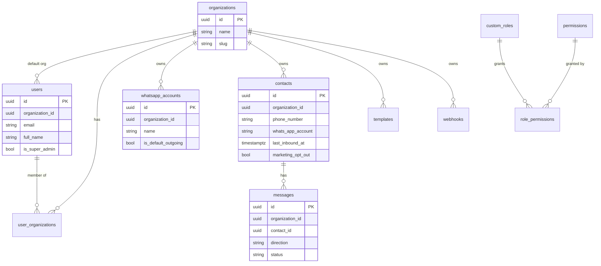

## `wl` schema bookkeeping

| Table | Columns | Owner |
| --- | --- | --- |
| `wl.schema_migrations` | `id varchar(255) PK` (`<module>/<migration id>`), `applied_at timestamptz` | `kit.RunMigrations` |

Redis keys: `wl:hooks:seen:<org>:<event>:<id>` (24 h, webhook de-duplication); `wl:booking:offer:<org>:<id>`
(30 min, chatbot time offers: labels, practitioner ids and times, no patient data); `wl:booking:rl:<bucket>:<hash>`
(public page rate limits, keyed by a hash of the IP or mobile, never the raw value);
`wl:consent:import:<org>:<token>` (15 min, a parsed opt-in CSV between preview and apply: digits-only numbers, dates
and notes); `wl:consent:sweep` (about 5 min, lock so one instance sweeps for Meta's opt-out changes).

## Modules

One section per module, filled in by prompt C when the module ships (copy its ER diagram from
`wl-docs/modules/<module>/design.md`).

### example

`wl.example_notes`: see [`modules/example/design.md`](modules/example/design.md).

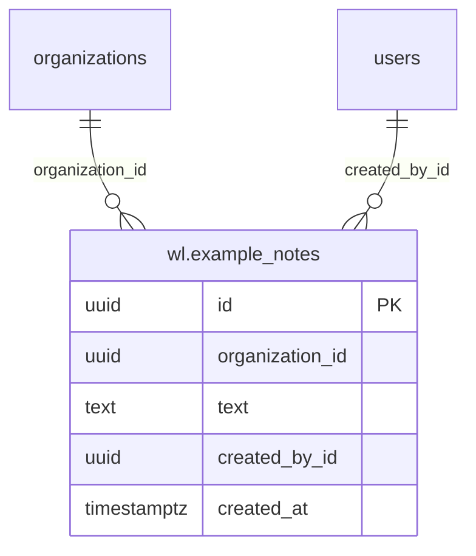

### practice

Clinic setup, built in Phase 1.1 (migration `practice/0001_create_practice`). Full column list and constraints:
[`modules/practice/design.md`](modules/practice/design.md#data-model).

| Table | What it holds | Key rules |
| --- | --- | --- |
| `wl.practice_profiles` | One row per organization: name, IANA time zone, booking slug, slot length, ABN and contact details | `UNIQUE (organization_id)`; `booking_slug` unique across all organizations |
| `wl.practice_locations` | Sites, with name, address, phone and `is_active` | Name unique per org; never deleted, only deactivated |
| `wl.practice_practitioners` | Display name, role, AHPRA number, optional `user_id` → `users.id`, `is_active` | One practitioner per user per org; the user must belong to the org (checked in the service) |
| `wl.practice_practitioner_locations` | Which locations a practitioner works at | Composite FKs to both sides, `ON DELETE CASCADE` |
| `wl.practice_services` | Appointment types: duration, price in cents (incl. GST), `allowed_roles jsonb` | Name unique per org; duration a whole number of slots, 5 to 480 minutes |
| `wl.practice_hours` | One row per open weekday per location, in minutes after local midnight | No row = closed; `closes_minute > opens_minute`; times on the slot grid |
| `wl.practice_closures` | Closed days for one location (`location_id`) or all (`NULL`), inclusive dates, reason | `ends_on >= starts_on`; hard-deleted when removed |

Cross-organization links are refused by the database as well as the service: every child table carries
`organization_id` and references its parent through a composite `(organization_id, id)` foreign key. The only links
to Weline tables are `organization_id` and `practitioners.user_id`, by id with no FK. No patient data.

Other modules read this through the Go service (`GetProfile`, `ActiveLocations`, `ActivePractitioners`,
`ActiveServices`, `IsOpen`), never by querying the tables.

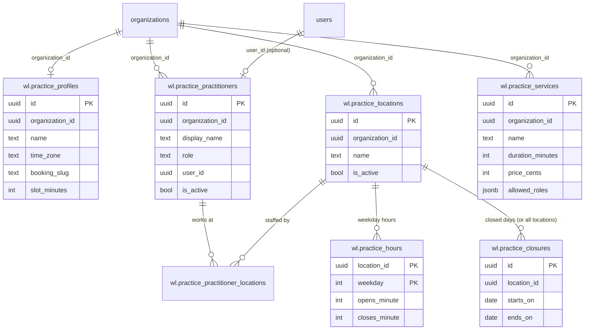

### booking

Appointments, built in Phase 1.2 (migration `booking/0001_create_booking`, which also creates the `btree_gist`
extension). Full columns and constraints: [`modules/booking/design.md`](modules/booking/design.md#data-model).

| Table | What it holds | Key rules |
| --- | --- | --- |
| `wl.booking_settings` | Per-clinic online booking rules: minimum notice, booking window | One row per org; no row = defaults (2 hours, 60 days) |
| `wl.booking_availability` | Practitioners' weekly working blocks per location, in local minutes | Composite FKs to practice practitioners and locations; blocks for one practitioner and weekday never overlap (exclusion constraint) |
| `wl.booking_blocks` | One-off time off (leave, meetings) as UTC instants, with a reason | Composite FK to the practitioner |
| `wl.booking_appointments` | Who (`contact_id`), with whom, what, where, when, status, source (`staff`, `web`, `whatsapp`), 6-character reference, short admin note | **Exclusion constraint on practitioner and time range (cancelled excluded): no double booking**; composite FKs to practice practitioner, service and location; reference unique per org |
| `wl.booking_status_history` | Every status change and move, who made it, reason | Append-only; cascades with its appointment |

**Patient data:** appointments link to upstream `contacts` by id; booking stores no name or phone of its own. Web
bookings may **create** a contact (name and mobile) on the clinic's default WhatsApp account. The note field is
administrative only. Retention: 7 years after the appointment, deletion job to build before real patient data.

Other modules call the Go service (`SearchSlots`, `Create`, `Move`, `SetStatus`, `Get`, `List`), never the tables.
The legacy prototype's `public.booking_appointments` is no longer used; drop it by hand.

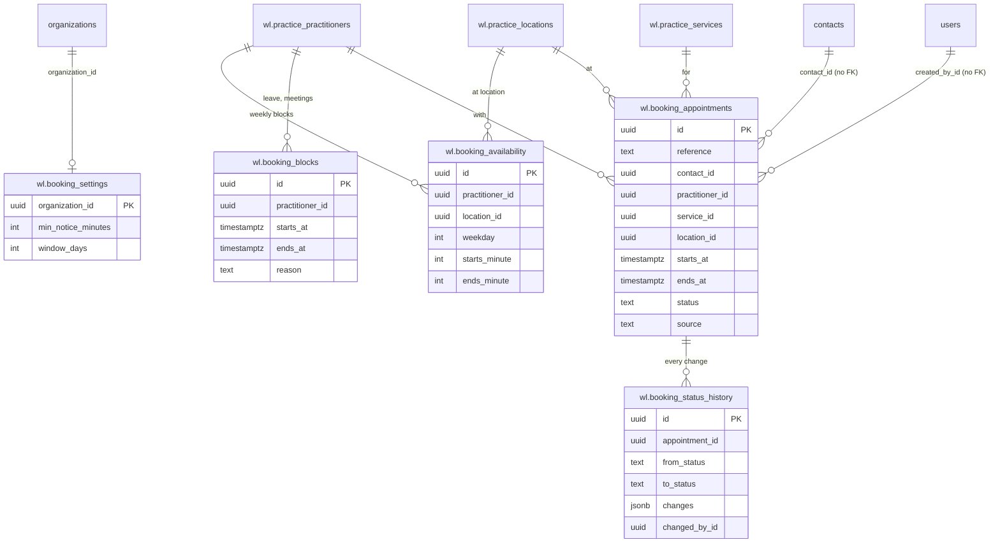

### ads

Entry points and arrivals, built in Phase 2.3 (migration `ads/0001_create_ads`).
Full design: [`modules/ads/design.md`](modules/ads/design.md#data-model).

| Table | What it holds | Key rules |
| --- | --- | --- |
| `wl.ads_entrypoints` | An ad, flyer, QR code or website button: name, `code` (upper case), `channel`, `campaign` label, `wa_number` (digits), `prefill_text`, `tag`, `tag_campaign`, `archived_at`, who created and last changed it | `UNIQUE (organization_id, code)`: codes are never reused while the row exists; code check (3–12 letters and digits with at least one of each) and number check in the database; `UNIQUE (organization_id, id)` for the composite key |
| `wl.ads_arrivals` | One row per arrival: entry point, contact, the message it came from, the matched `code`, `arrived_at` (the message's time), `is_new` | Append-only; composite FK `(organization_id, entrypoint_id)` with `ON DELETE RESTRICT` (an entry point with arrivals can only be archived); `UNIQUE (organization_id, message_id)` |

**Upstream rows it writes:** `contacts.tags` (adds the entry point's tag and campaign tag, never removes) through
`models.Contact`, and rows in `tags` (the organization's tag list, colour purple) through `models.Tag`, both
organization-scoped.

**Reads:** `contacts` (`tags`, `profile_name`, `phone_number`, `deleted_at`), `messages` (`created_at` of the arrival's
message and the contact's first incoming message), `wl.consent_events` (opt-ins after an arrival) and
`wl.booking_appointments` (`created_at`, `source` other than `cliniko`) for the counts.

**Patient data:** an arrival ties a contact to an ad they answered, which can hint at a health interest. The matched
code is stored, never the message text. Numbers reach the browser masked.

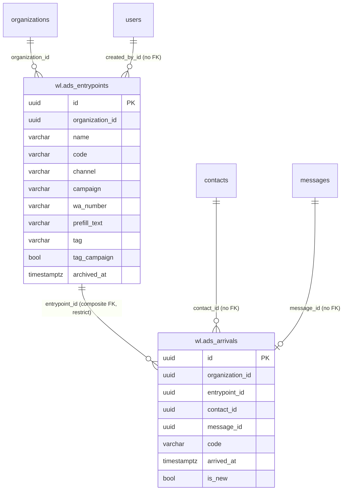

### audit

The trail of module changes, built in step 3.3 (migration `audit/0001_create_audit_events`). Details:
[`modules/audit/README.md`](modules/audit/README.md).

| Table | What it holds | Key rules |
| --- | --- | --- |
| `wl.audit_events` | Who (`actor_user_id`) changed what (`module`, `action`, `entity`, `entity_id`) and when (`at`), with details that never hold personal data or secrets | Append-only; index `(organization_id, at DESC)`; admins read it |

### ai

The AI agent, built in Phase 4 (migration `ai/0001_create_ai`). Full design: [`modules/ai/design.md`](modules/ai/design.md).

| Table | What it holds | Key rules |
| --- | --- | --- |
| `wl.ai_settings` | On/off, hand-over team, tone, instructions, confidence threshold, emergency words | One row per organization; no row = off |
| `wl.ai_knowledge` | FAQ entries and document chunks with a generated `tsvector` for full-text search | GIN index; deleted by `source_id` |
| `wl.ai_runs` | Per message: intent, confidence, outcome, knowledge sources, prompt version, latency, tokens; no text | `UNIQUE (organization_id, message_id)`; purged after 90 days |

**Reads:** `chatbot_settings` (`ai_provider`, `ai_model`, `ai_api_key` decrypted on the server, `ai_max_tokens`),
`contacts` (name and number for the connector), `organizations.name`. **Writes through upstream:** agent transfers (via
the `HandOver` accessor) and messages (via `kit.Sender`).

### reminders

Reminders and recalls, built in Phase 5 (migration `reminders/0001_create_reminders`). Full design:
[`modules/reminders/design.md`](modules/reminders/design.md).

| Table | What it holds | Key rules |
| --- | --- | --- |
| `wl.reminder_rules` | Kind (`reminder` or `recall`), name, offset before the appointment or days after a visit, approved template and language, variables in order, services, on/off | Checks on kind and ranges; `UNIQUE (organization_id, id)` for the composite key below |
| `wl.reminder_sends` | One row per reminder (rule, appointment id, start time) or recall (rule, customer id, month): status and skip reason, the Weline contact and message, the patient's reply | `UNIQUE (organization_id, rule_id, target_id, start_at)` so nothing is sent twice; composite FK to the rule, `ON DELETE CASCADE`; no message text or numbers |

**Reads through the connector:** appointments (live, never copied) and the customer's name and mobile
(`provider.GetCustomer`). **Writes through upstream:** contacts for patients who never wrote (number and name, on the
default WhatsApp account), messages (via `kit.Sender`) and agent transfers (via `HandOver`). **Writes through the
connector:** confirm and cancel.

### onboarding

Sign-up and the setup checklist, built in step 6.1 (migration `onboarding/0001_create_onboarding`). Full design:
[`modules/onboarding/design.md`](modules/onboarding/design.md).

| Table | What it holds | Key rules |
| --- | --- | --- |
| `wl.onboarding_state` | How the organization started (`signup` or `existing`), who signed up, the type of business, when the checklist was hidden | One row per organization; FK to `organizations` with cascade; the checklist itself is worked out, not stored |

**Writes to upstream tables (sign-up only, for the new organization):** `organizations`, its system `custom_roles` and
`role_permissions` (upstream's own seeding function), `chatbot_settings`, `users` (email, bcrypt hash, name),
`user_organizations`. **Reads:** `whatsapp_accounts`, `user_organizations`, `messages` (existence only).

### kit

| Table | What it holds | Key rules |
| --- | --- | --- |
| `wl.kit_permission_grants` | Which module permission each organization's system roles have been given (`organization_id`, `resource`, `action`) | PK on all three; written by `kit.GrantMissing`; FK to `organizations` with cascade |

### packs

Industry packs, built in step 7.1 (migration `packs/0001_create_packs`). Packs themselves are files in the binary,
not tables. Full design: [`modules/packs/design.md`](modules/packs/design.md).

| Table | What it holds | Key rules |
| --- | --- | --- |
| `wl.packs_installs` | Each install: pack, version, what it did (item names and statuses), who, when | FK to `organizations` with cascade; no personal data |

**Writes through other modules:** `templates` (drafts), `wl.ai_settings`, `wl.audiences_segments`,
`wl.reminder_rules` (off).

### operator

The operator console (step 6.3) has **no tables**: it reads `organizations`, `wl.onboarding_state`,
`wl.billing_subscriptions`, `wl.connector_accounts`, `wl.audiences_sends`, `wl.ai_runs`, `wl.reminder_sends`,
`wl.practice_profiles`, `contacts`, `messages`, `whatsapp_accounts`, `user_organizations` (counts and states only) and
writes `wl.audit_events`. See [`modules/operator/design.md`](modules/operator/design.md).

### billing

Plans, limits and Stripe subscriptions, built in step 6.2 (migration `billing/0001_create_billing`). Full design:
[`modules/billing/design.md`](modules/billing/design.md).

| Table | What it holds | Key rules |
| --- | --- | --- |
| `wl.billing_subscriptions` | Plan, Stripe status, trial end, period end, cancel flag, Stripe customer and subscription ids, last event time | One row per organization (FK cascade), made when billing first sees it; no card details |
| `wl.billing_events` | Stripe event ids already applied, with type and organization | PK on the event id: a retried event applies once |

**Reads (usage, counts only):** `wl.audiences_sends`, `wl.ai_runs`, `wl.connector_accounts`, `contacts`,
`user_organizations`, `whatsapp_accounts`, outgoing template `messages` joined to `templates` for the category.

### audiences

Segments and the campaigns created from them, built in Phase 2.1 (migration `audiences/0001_create_audiences`).
Full design: [`modules/audiences/design.md`](modules/audiences/design.md#data-model).

| Table | What it holds | Key rules |
| --- | --- | --- |
| `wl.audiences_segments` | A named set of rules over contacts (`rules` jsonb: tag, contact field, WhatsApp number, activity, past campaign), description, who created and last changed it | Name unique per org among live rows; soft delete (`deleted_at`); `UNIQUE (organization_id, id)` for the composite key below |
| `wl.audiences_sends` | One row per campaign created here: `kind` (`segment` or `retarget`), the segment or source campaign and filter, the upstream `campaign_id`, a snapshot of the rules and variable mapping, recipient count and exclusions by reason, who created it | Append-only; `kind = 'segment'` exactly when there's no source campaign; composite FK `(organization_id, segment_id)` so a send can't point at another org's segment (`ON DELETE SET NULL (segment_id)`) |

**Upstream rows it writes:** a draft `bulk_message_campaigns` row and its `bulk_message_recipients` (phone number in
digits, the contact's name, and the rendered template variables, which may include contact field values), through
upstream's models in one transaction, the same rows Weline's own recipient import writes. Campaigns and recipients
follow upstream's lifecycle (deleted with the campaign).

**Reads:** `contacts` (`tags`, `metadata`, `whats_app_account`, `last_inbound_at`, `last_message_at`,
`marketing_opt_out`, `created_at`), `bulk_message_campaigns` / `bulk_message_recipients` (status, `sent_at`,
`read_at`) for campaign rules and retargets, incoming `messages` (`contact_id`, `created_at`) for "replied",
`templates`, `tags`, `whatsapp_accounts`. Contacts are matched to campaign recipients by phone number with
non-digits removed.

**Patient data:** segments hold rules, not people; a segment's contacts are worked out each time. The send row
keeps counts only. Names and numbers reach the browser only as the masked sample (first 2 and last 3 digits).

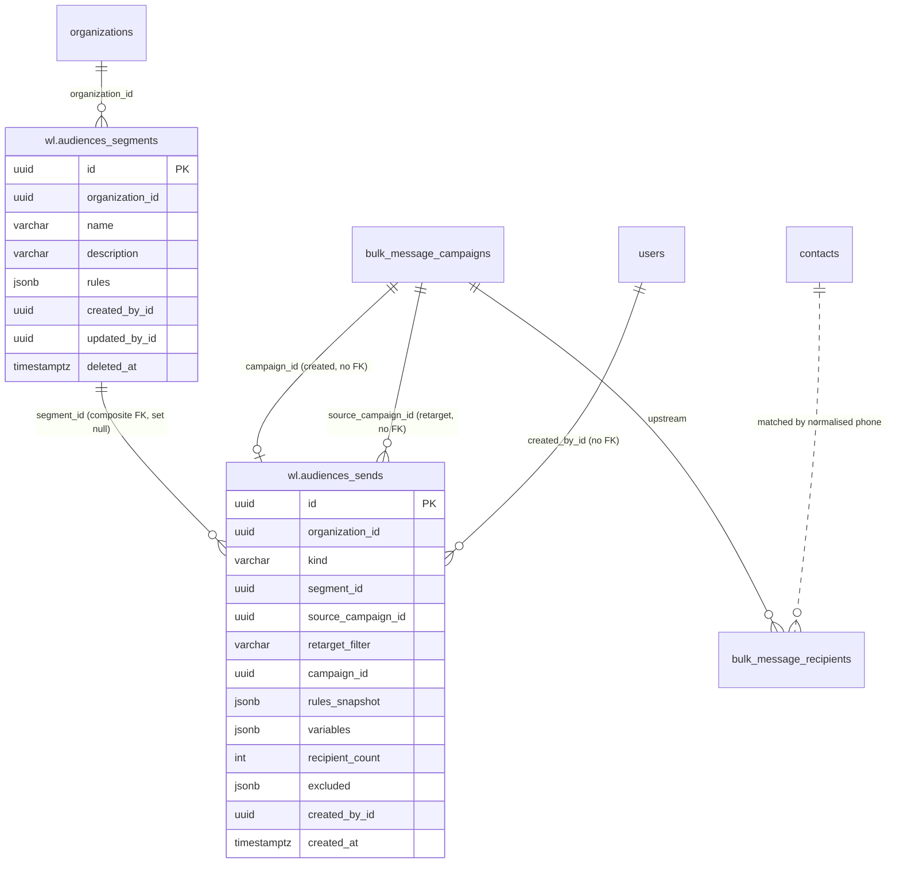

### connectors

The connected system, links and sync log, built in Phase 3.1 (migration `connectors/0001_create_connectors`).
Full design: [`modules/connectors/design.md`](modules/connectors/design.md#data-model).

| Table | What it holds | Key rules |
| --- | --- | --- |
| `wl.connector_accounts` | The organization's provider (`builtin`, `cliniko`), its credentials encrypted with Weline's `encryption_key`, status, settings (no secrets), last test, last sync, last error, who changed it | One row per organization (PK); no row = built-in; credentials never returned by the API |
| `wl.connector_links` | Weline record ↔ provider record: `entity` (`contact`, `appointment`, `phone`), `local_id`, `remote_id`, and for `phone` a SHA-256 of the organization id and the mobile's digits | One link per Weline record and per remote id; `phone` rows have no `local_id` and always a hash; numbers are never stored |
| `wl.connector_syncs` | Connection tests and sync runs: kind, start, finish, outcome, counts, a safe error message | Append-only; the last 100 per organization kept |

**Upstream rows it writes:** none. **Reads:** none directly; the built-in provider is Booking.

**Secrets:** a connected system's key opens the clinic's records there (for Cliniko, patient records). It's encrypted at
rest and only decrypted to build the provider for a request.

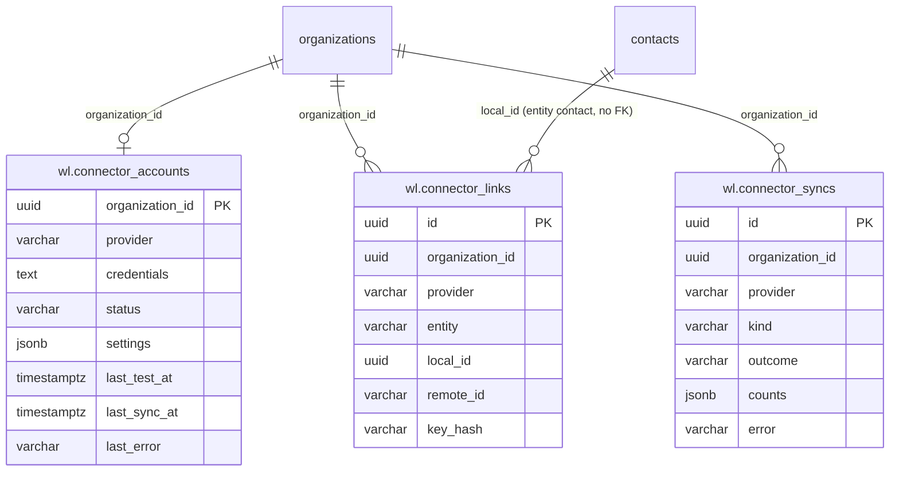

### consent

Opt-in, opt-out and the consent history, built in Phase 2.2 (migration `consent/0001_create_consent`).
Full design: [`modules/consent/design.md`](modules/consent/design.md#data-model).

| Table | What it holds | Key rules |
| --- | --- | --- |
| `wl.consent_settings` | Per-organization opt-out and opt-in word lists, opt-in button phrases, the two reply texts, the opt-out tag, `require_opt_in` and `service_after_stop` (`continue`/`stop`) | One row per organization; no row = defaults |
| `wl.consent_status` | Current marketing consent per contact: `opted_in` or `opted_out`, its source and date, and the event that set it | PK `(organization_id, contact_id)`; no row = not recorded; `opted_out` always matches `contacts.marketing_opt_out`, and the sweep repairs any difference; composite FK to the last event |
| `wl.consent_events` | Every opt-in and opt-out: action, source (`keyword`, `button`, `staff`, `import`, `meta`; `ad`, `web_form` reserved), state before, when given and recorded, who recorded it, the upstream message id, the matched keyword (never the message text), the evidence note, the import | **Append-only** (the module has no update or delete); `UNIQUE (organization_id, id)`; composite FK to the import |
| `wl.consent_imports` | One row per applied CSV: file name, proof description, row counts by outcome, who imported it | `UNIQUE (organization_id, id)`; the file itself isn't stored |

**Upstream rows it writes:** `contacts.marketing_opt_out` and `contacts.tags` (adds or removes the opt-out tag),
through upstream's `models.Contact`, in the same transaction as the consent event. It sends confirmation replies
through `kit.Sender`, which stores them as ordinary outgoing `messages`.

**Reads:** `contacts` (`phone_number`, `profile_name`, `marketing_opt_out`, `tags`, `deleted_at`), `organizations.name`
(for `{business}` in replies), `users.full_name` and `user_organizations` (who recorded a change). Audiences reads
`wl.consent_status` and `wl.consent_settings` for its Consent rule and `no_opt_in` exclusion.

**Patient data:** the history ties a contact to consent decisions, staff notes (which may name a form or date) and
the matched keyword. Numbers reach the browser masked (first 2 and last 3 digits). Imported files aren't stored; the
parsed rows sit in Redis for 15 minutes between preview and apply.

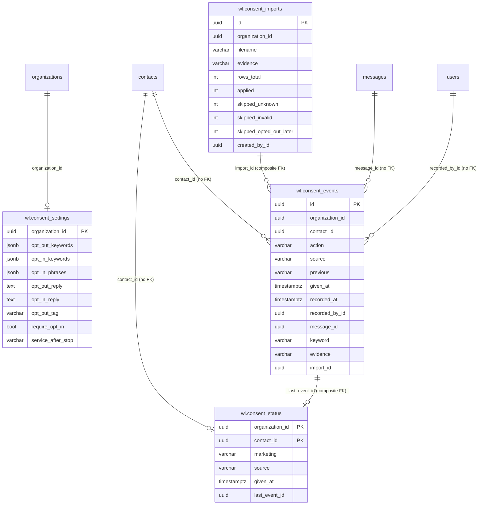

### calendar

_Not built yet (Phase 1.3). Expected to read booking and practice tables only._

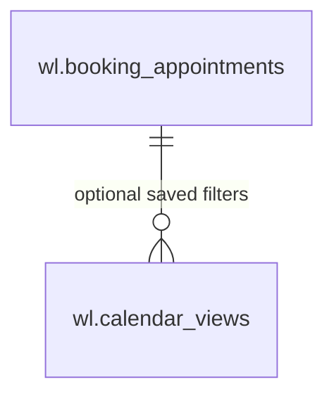

### reminders

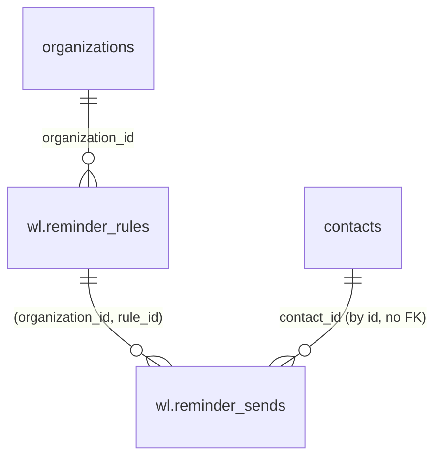

### ai

_Not built yet (Phase 3)._

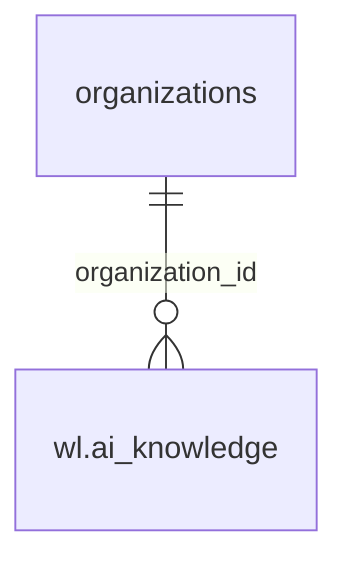

### connectors

_Not built yet (Phase 4)._

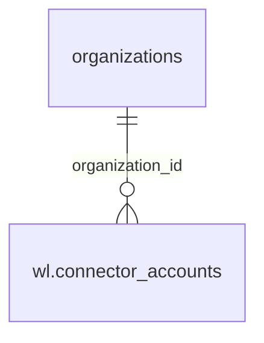

### crm

_Not built yet (Phase 5)._

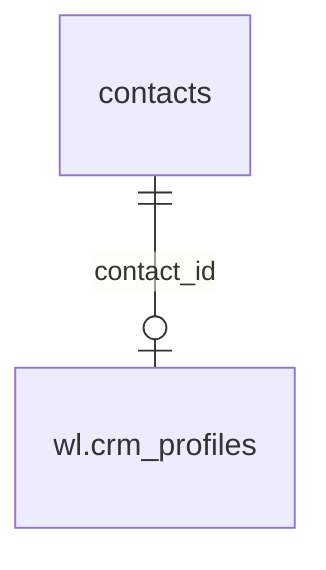
