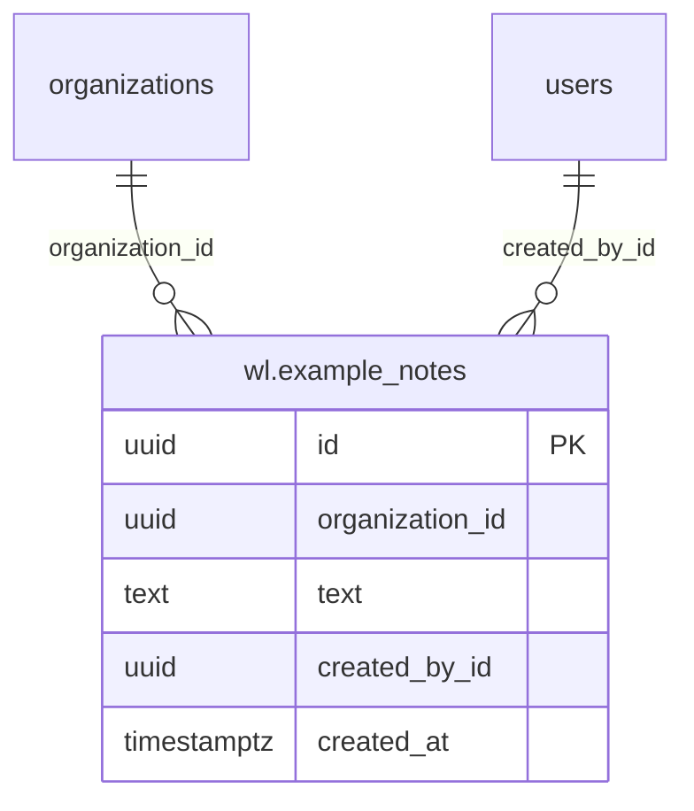
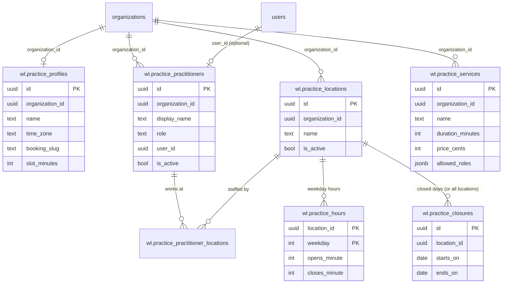
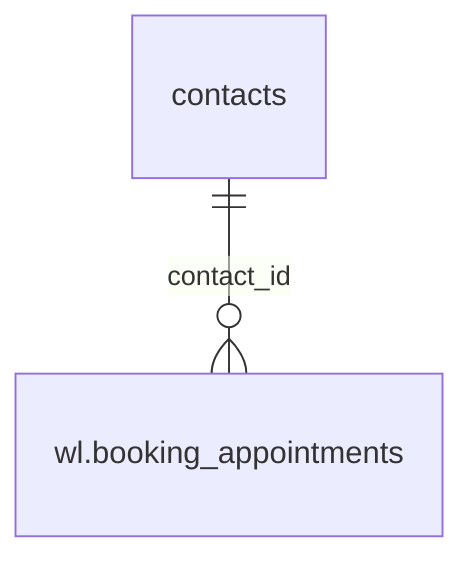
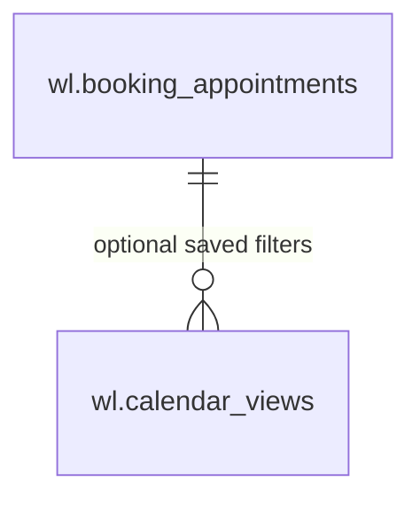
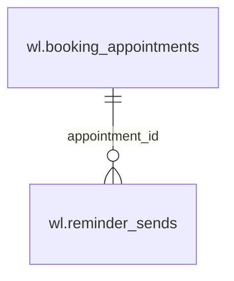
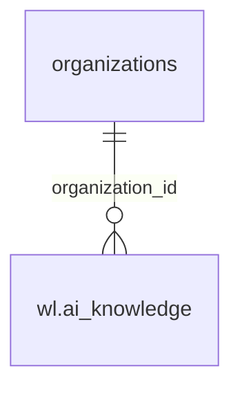
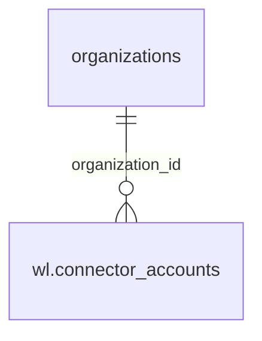
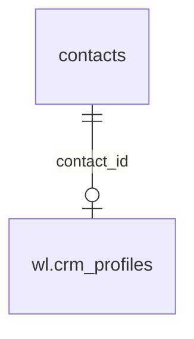

# Weline data model

What modules store, and what they rely on in Weline's own tables. Architecture:
[`architecture.md`](architecture.md). Security: [`threat-model.md`](threat-model.md).

## Rules for module data (`wl` schema)

- Every module table lives in the Postgres schema `wl`, named `wl.<module>_<thing>`, created by a
  versioned `kit.Migration` (never `AutoMigrate`), recorded in `wl.schema_migrations` as `<module>/<id>`.
- Migrations are additive and have a working `Down`. Never edit a released migration; add a new one.
- Every table has `organization_id uuid NOT NULL`, indexed (usually with the column you sort by), and every
  query filters on it. Services take `orgID` as their first argument.
- Never add columns to upstream tables, and don't put foreign-key constraints into upstream tables either:
  link by id (`contact_id`, `user_id`, `whatsapp_account_id`) and check org ownership in the service.
- Times are `timestamptz` in UTC. Each practice has an IANA time zone (default `Australia/Sydney`) for display
  and slot maths.
- External ids from connectors go in `wl.connector_links (entity, local_id, provider, remote_id)`, never as
  columns on other tables.
- Secrets (connector keys, AI keys) are encrypted with Weline's `crypto.EncryptFields` and the app's
  `encryption_key`; never logged, never returned to the browser.
- Patient data is administrative only (no clinical notes), and each table that holds it has a retention rule.

## Weline tables modules link to

Columns modules may read and rely on. Treat everything else as upstream-internal. Column names are GORM's
snake_case of the Go field: `WhatsAppAccount` → **`whats_app_account`**, `WhatsAppMessageID` →
**`whats_app_message_id`**.

| Table | Columns we rely on | Notes |
| --- | --- | --- |
| `organizations` | `id`, `name`, `slug`, `deleted_at` | The tenant. Every module row has `organization_id` = `organizations.id`. |
| `users` | `id`, `organization_id` (default org), `email`, `full_name`, `is_active`, `is_super_admin`, `role_id` | Staff. A user can belong to several orgs through `user_organizations (user_id, organization_id, role_id, is_default)`; the active org comes from `X-Organization-ID` (use `kit.OrgID`, not the token's default). |
| `contacts` | `id`, `organization_id`, `phone_number`, `profile_name`, `whats_app_account` (account **name**), `assigned_user_id`, `last_inbound_at` (24-hour window), `marketing_opt_out`, `tags`, `deleted_at` | A WhatsApp customer, the clinic's patient. Modules link by `contact_id` and never copy phone or name. |
| `messages` | `id`, `organization_id`, `contact_id`, `whats_app_account`, `whats_app_message_id`, `direction` (`incoming`/`outgoing`), `message_type`, `status` (`pending`/`sent`/`delivered`/`read`/`failed`/`received`), `template_name`, `sent_by_user_id`, `created_at` | Modules read status by id (e.g. reminder sends). `content` is message text: never log it. |
| `whatsapp_accounts` | `id`, `organization_id`, `name` (unique per org; contacts/messages/templates reference it by name), `phone_id`, `is_default_outgoing`, `status` | `access_token`, `app_secret`, `pin` are encrypted and only ever handled by core (`kit.Sender` resolves accounts through core). |
| `templates` | `organization_id`, `whats_app_account`, `name`, `language`, `status` (`APPROVED` to send) | Per WhatsApp account; `kit.Sender.SendTemplate` checks approval. |
| `webhooks` | (managed row) `organization_id`, `name` = "Weline modules (managed, do not edit)", `url`, `events`, `headers`, `secret`, `is_active` | Created by `internal/modules/hooks`; the receiver reads `secret`. |
| `permissions`, `custom_roles`, `role_permissions` | `permissions.resource`, `action`; `custom_roles.name`, `is_system` | Module permissions (`wl_<module>_<thing>`) are inserted by `kit.SeedPermissions`. |

## `wl` schema bookkeeping

| Table | Columns | Owner |
| --- | --- | --- |
| `wl.schema_migrations` | `id varchar(255) PK` (`<module>/<migration id>`), `applied_at timestamptz` | `kit.RunMigrations` |

Redis keys: `wl:hooks:seen:<org>:<event>:<id>` (24 h, webhook de-duplication).

## Modules

One section per module, filled in by prompt C when the module ships (copy its ER diagram from
`wl-docs/modules/<module>/design.md`).

### example

`wl.example_notes`: see [`modules/example/design.md`](modules/example/design.md).

### practice

Clinic setup, built in Phase 1.1 (migration `practice/0001_create_practice`). Full column list and constraints:
[`modules/practice/design.md`](modules/practice/design.md#data-model).

| Table | What it holds | Key rules |
| --- | --- | --- |
| `wl.practice_profiles` | One row per organization: name, IANA time zone, booking slug, slot length, ABN and contact details | `UNIQUE (organization_id)`; `booking_slug` unique across all organizations |
| `wl.practice_locations` | Sites, with name, address, phone and `is_active` | Name unique per org; never deleted, only deactivated |
| `wl.practice_practitioners` | Display name, role, AHPRA number, optional `user_id` → `users.id`, `is_active` | One practitioner per user per org; the user must belong to the org (checked in the service) |
| `wl.practice_practitioner_locations` | Which locations a practitioner works at | Composite FKs to both sides, `ON DELETE CASCADE` |
| `wl.practice_services` | Appointment types: duration, price in cents (incl. GST), `allowed_roles jsonb` | Name unique per org; duration a whole number of slots, 5 to 480 minutes |
| `wl.practice_hours` | One row per open weekday per location, in minutes after local midnight | No row = closed; `closes_minute > opens_minute`; times on the slot grid |
| `wl.practice_closures` | Closed days for one location (`location_id`) or all (`NULL`), inclusive dates, reason | `ends_on >= starts_on`; hard-deleted when removed |

Cross-organization links are refused by the database as well as the service: every child table carries
`organization_id` and references its parent through a composite `(organization_id, id)` foreign key. The only links
to Weline tables are `organization_id` and `practitioners.user_id`, by id with no FK. No patient data.

Other modules read this through the Go service (`GetProfile`, `ActiveLocations`, `ActivePractitioners`,
`ActiveServices`, `IsOpen`), never by querying the tables.

### booking

_Not built yet (Phase 1.2)._

### calendar

_Not built yet (Phase 1.3). Expected to read booking and practice tables only._

### reminders

_Not built yet (Phase 2)._

### ai

_Not built yet (Phase 3)._

### connectors

_Not built yet (Phase 4)._

### crm

_Not built yet (Phase 5)._

