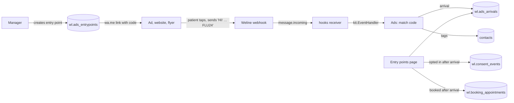
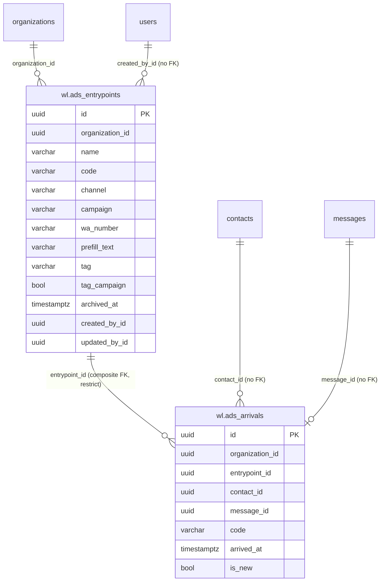

# Ads: design

Requirements: [`requirements.md`](requirements.md). API: [`api.md`](api.md). Route: [spike](spike.md) option c1.

## How it fits Weline

- **No upstream change.** The module reads `message.incoming` through the hooks receiver, like Consent, and adds tags
  through upstream's `models.Contact`.
- **It sends nothing.** The patient's message goes on to Weline's chatbot and inbox as usual.
- Upstream's chat shows the message as typed, code included. Staff learn to read "[FLU24]" as "came from the flu ad".

## Data model

All tables in schema `wl`, every row carries `organization_id`, all times UTC.

| Table | Columns | Notes |
| --- | --- | --- |
| `wl.ads_entrypoints` | `id`, `organization_id`, `name` varchar(100), `code` varchar(12) (stored upper case), `channel` varchar(10) `meta_ad`/`google_ad`/`website`/`print`/`email`/`other`, `campaign` varchar(60) (`''` = none), `wa_number` varchar(15) (digits), `prefill_text` varchar(500), `tag` varchar(50), `tag_campaign` bool, `archived_at`, `created_by_id`, `updated_by_id`, `created_at`, `updated_at` | `UNIQUE (organization_id, code)`, so codes are never reused while the row exists (archived rows are kept, R3); `UNIQUE (organization_id, id)` for the composite key; `CHECK (code ~ '^[A-Z0-9]{3,12}$' AND code ~ '[A-Z]' AND code ~ '[0-9]')`; `prefill_text` must contain the code (checked in the service) |
| `wl.ads_arrivals` | `id`, `organization_id`, `entrypoint_id`, `contact_id`, `message_id`, `code` varchar(12), `arrived_at`, `is_new` bool | Append-only. Composite FK `(organization_id, entrypoint_id)` → entry points (`ON DELETE RESTRICT`, so an entry point with arrivals can only be archived); `UNIQUE (organization_id, message_id)` (one arrival per message); indexes `(organization_id, entrypoint_id, arrived_at DESC)` and `(organization_id, contact_id, arrived_at DESC)` |

`contact_id` and `message_id` link upstream `contacts` and `messages` by id (no FK, as in other modules).

Permissions are seeded by the migration (R11): `wl_ads_entrypoints` read, create, update and delete for `admin` and
`manager`.

## Matching (R4–R7)

On `message.incoming` with `message_type` text and at most 1,000 characters:

1. Load the organization's **active codes** (code → entry point id, tag, campaign tag), cached in memory for 60
   seconds and dropped on any change to entry points on that instance.
2. Split the text into tokens on anything that isn't a letter or digit, upper-case them, and take the first token that
   is an active code. None → return.
3. In one transaction, holding `pg_advisory_xact_lock` on (organization, contact) so two messages from the same
   contact can't both pass the 24-hour check:
   - skip if an arrival exists for this message id, or for this contact and entry point in the last 24 hours;
   - `is_new` = the contact's earliest incoming message in `messages` (organization-scoped) is at most 10 minutes
     before this one;
   - insert the arrival;
   - add the tag (and campaign tag) to `contacts.tags`, case-insensitive and de-duplicated, through
     `models.Contact` filtered by organization.
4. A contact id from another organization finds no contact and does nothing.

Hooks de-duplicate deliveries, and the unique message id makes a repeat a no-op anyway.

## Reports (R9, R10)

For a period `[from, to)` on `arrived_at`, one grouped query per page:

- `conversations` = arrivals in the period; `new_contacts` = those with `is_new`.
- `opted_in` = contacts with a Consent `opt_in` event whose `given_at` is within 30 days after an arrival in the
  period, where that arrival is the contact's **latest** arrival before the opt-in (a `LATERAL` lookup on the
  contact index).
- `booked` = the same rule over `wl.booking_appointments.created_at` (any status; source `staff`, `web` or
  `whatsapp`, not `cliniko`).
- Campaign totals add up their entry points. Archived entry points appear only with `include_archived`.

## Screens

| Page | Content | States |
| --- | --- | --- |
| **Entry points** `/x/ads` (sidebar: its own Ads section, "Entry points") | Period picker (7, 30, 90 days, custom); campaign totals; table: name, code, channel, campaign, conversations, new, opted in, booked, copy-link button; "Show archived"; "New entry point" | loading · empty (explains what an entry point is, with a "New entry point" button) · error · forbidden |
| **Entry point** `/x/ads/{id}` | Link with copy buttons (link, and the message to paste in Meta Ads Manager); settings; the same counts; recent arrivals (when, name, masked number, new/returning, opted in, booked); Edit, Archive, Delete (only with no arrivals) | read-only without `update`/`delete` |
| **New / edit entry point** (dialog) | Name; code (suggested from the name: the first word's first three letters plus the last two digits in the name, or the year's; editable on create only); channel; campaign (pick or type); WhatsApp number (remembered in the browser); pre-filled message with the code (preview of the link); tag and campaign tag | code clash → message on the field |

## WhatsApp templates

None. The module sends nothing.

## Threats

| Threat | Protection |
| --- | --- |
| **Fake arrivals** (anyone can type a code, so counts and tags can be inflated) | Low impact: it only adds marketing tags and counts. One arrival per contact, entry point and day; only messages through the verified hooks receiver count. Open risk: counts are indicative, not proof. |
| **Codes matching ordinary words** | Codes need a letter and a digit, 3–12 characters, whole-token match only. |
| **Cross-organization data** | Every query filtered by `organization_id`; composite keys; contact looked up inside the event's organization; tested with a second organization. |
| **Personal data** (an arrival ties a patient to an ad they responded to, which can hint at a health interest, for example "skin check offer") | Only the code is stored, never the message; numbers masked in responses; no names, numbers or text in logs; reception has no access by default. Retention follows the contact (no deletion job in this slice, like Consent). |
| **Malicious links** (a manager sets a number or text that sends patients elsewhere) | Number is digits only (8–15); text ≤ 500 characters and must contain the code; link built by the server with URL encoding; editing needs `update`. |
| **Tag pollution** (tags that break Audiences or the chat) | Tags ≤ 50 characters, letters, digits, `-` and `_` only, generated by default; the module only adds tags. |
| **Event floods** | Code set cached; one small transaction per matching message; non-matching messages cost one in-memory lookup. |

**Open risks:**
- Counts depend on patients keeping the code in their message. Edited messages are missed, so numbers are a lower
  bound.
- Upstream's chatbot greeting or AI reply still answers the first message as usual (expected, not a fault).
