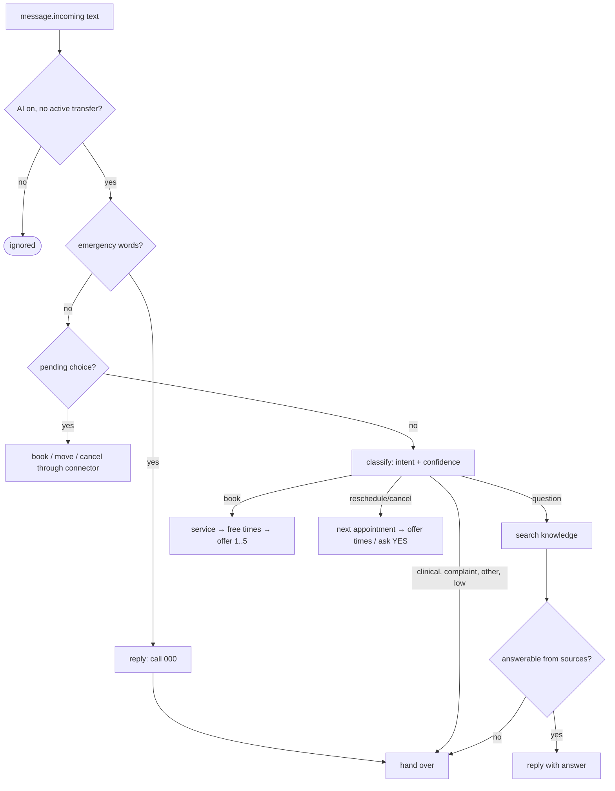
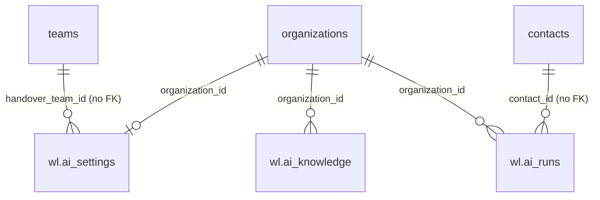

# AI agent: design

Requirements: [`requirements.md`](requirements.md). API: [`api.md`](api.md).

## What we reuse and what we add

| Weline already has | We reuse | We add |
| --- | --- | --- |
| Chatbot → AI settings (provider, model, encrypted key, max tokens) | Provider, model and key from the organization's default `chatbot_settings` row, decrypted with `encryption_key` | `kit.LLM` interface and three small clients (Anthropic, OpenAI, Google) in `internal/modules/ai/llm.go`; upstream's own clients are tied to its chatbot session |
| AI contexts (static/API context, keyword triggers) in the chatbot | Nothing directly: they feed upstream's chatbot replies | A knowledge base with sources, chunking and search |
| Agent transfers | `HandOver` accessor in `internal/handlers/weline_hooks.go` (Weline file) using upstream's transfer code | Handover notes ("AI: clinical question") and the team |
| Connector interface (3.1) | `provider.Resolver` from the registry | The booking conversation |

**Running alongside upstream's chatbot:** both receive incoming messages. With the agent on, turn off the chatbot's own
AI and fallback reply (the settings page says so), or the patient gets two answers.

## Pipeline

Pending choices live in Redis (`wl:ai:pending:<org>:<contact>`, 30 minutes): the kind, the provider's ids and times.

## Data model

| Table | Columns | Notes |
| --- | --- | --- |
| `wl.ai_settings` | `organization_id` PK, `enabled`, `handover_team_id`, `tone` varchar(20), `instructions` text (≤ 4,000), `confidence_threshold` numeric(3,2), `emergency_words` jsonb, `updated_by_id`, `updated_at` | No row = off with defaults |
| `wl.ai_knowledge` | `id`, `organization_id`, `kind` (`faq`, `document`), `title` varchar(200), `source_id` uuid (all chunks of one item share it), `chunk` int, `content` text, `search` tsvector (generated, `english`), `created_by_id`, `created_at` | GIN index on `search`; delete by `source_id` |
| `wl.ai_runs` | `id`, `organization_id`, `contact_id`, `message_id`, `intent`, `confidence`, `outcome`, `sources` jsonb (knowledge source ids), `prompt_version`, `latency_ms`, `tokens_in`, `tokens_out`, `created_at` | `UNIQUE (organization_id, message_id)`; purged after 90 days |

## Prompts

`prompts.go` holds the classifier and answer prompts and `PromptVersion`. The classifier returns JSON
`{"intent": …, "confidence": 0–1, "service": "…"}`; the answerer returns `{"can_answer": bool, "answer": "…",
"sources": [n…]}` using only numbered knowledge passages. Both forbid clinical advice. Model output is parsed strictly;
anything else hands over.

## Threats

| Threat | Protection |
| --- | --- |
| **Clinical advice or a missed emergency** | Emergency words checked before any model call; clinical intent hands over; low confidence hands over; replies screened for advice markers; evals require 100% handover for clinical and emergency messages |
| **Prompt injection** ("ignore your instructions and…") | The model only chooses an intent and words a reply from given passages; actions (booking) need the patient's explicit numbered choice and run through the connector for the chat's own contact only; strict JSON parsing |
| **Wrong patient's appointment** | The contact is the chat's contact from the verified event; the connector looks up that contact's customer and appointments only |
| **Key exposure** | Key decrypted server-side per call; never returned, logged or put in runs |
| **Patient data to the AI provider** | The message text and knowledge passages go to the provider the clinic chose in Weline's settings; names and numbers aren't added by Weline. Open risk: the provider's data handling and location (choose a provider with an Australian or no-retention option) |
| **Cost or flood** | One run per message; hooks de-duplicate; timeouts; max tokens from settings |
| **Cross-organization data** | Every query by organization; knowledge searched within the organization only; tested |

**Open risks:** the AI provider's data location and retention; full-text search misses paraphrases (embeddings later).
