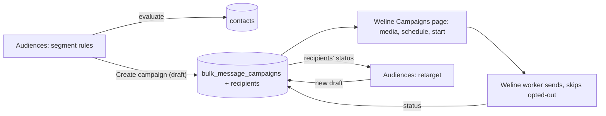
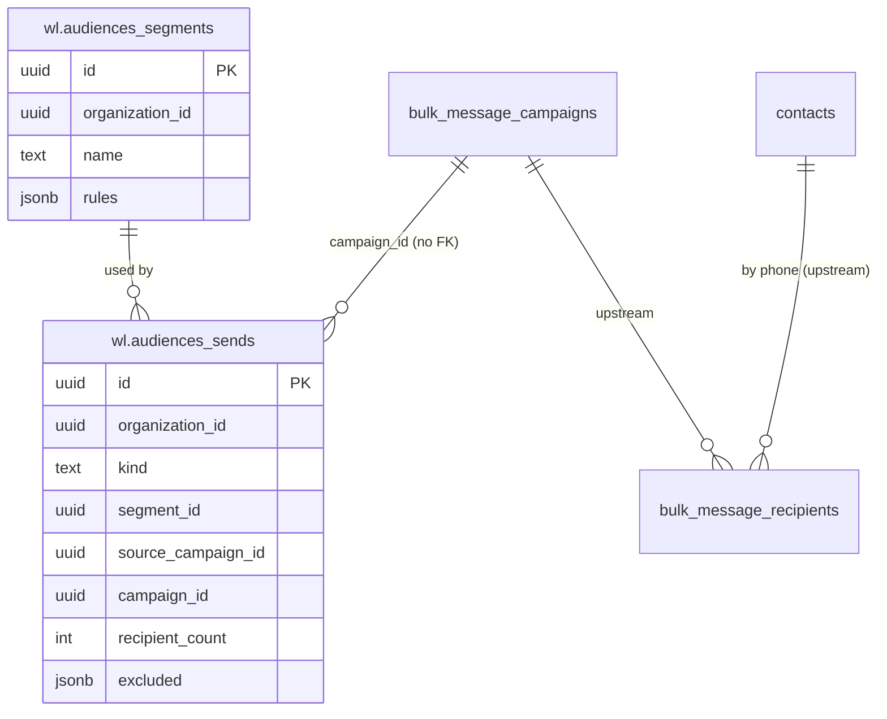

# Audiences: design

Requirements: [`requirements.md`](requirements.md). API: [`api.md`](api.md).

## How it fits Weline



Audiences **builds lists**; Weline's existing Campaigns **sends** them. Upstream code is untouched: the module creates
a draft `bulk_message_campaigns` row and its `bulk_message_recipients` through upstream's models (the same rows
Weline's recipient import writes), in one transaction, and reads `contacts`, `messages` and recipient statuses.

## Data model

Two tables in `wl`, created by `audiences/0001_create_audiences`, with a `Down` that drops them.

| Table | Columns | Constraints |
| --- | --- | --- |
| `wl.audiences_segments` | `id`, `organization_id`, `name` (≤ 120), `description` (≤ 500), `rules jsonb`, `created_by_id`, `updated_by_id`, timestamps, `deleted_at` | `UNIQUE (organization_id, id)`; `UNIQUE (organization_id, name) WHERE deleted_at IS NULL`; `rules` validated by the service |
| `wl.audiences_sends` | `id`, `organization_id`, `kind` (`segment` / `retarget`), `segment_id` (nullable), `source_campaign_id` (nullable, retarget), `retarget_filter` (nullable), `campaign_id`, `rules_snapshot jsonb`, `variables jsonb`, `recipient_count`, `excluded jsonb` (counts by reason), `created_by_id`, `created_at` | FK `(organization_id, segment_id)` → segments (`ON DELETE SET NULL`); `campaign_id` and `source_campaign_id` link to upstream `bulk_message_campaigns` by id, no FK; append-only |

No patient data of its own: segments hold rules, sends hold counts. Recipient phone numbers live in upstream's
recipients table, as for any campaign.



## Rules

```json
{ "match": "all",
  "conditions": [
    { "field": "tag", "op": "has", "value": "physio" },
    { "field": "metadata", "key": "patient_type", "op": "eq", "value": "new" },
    { "field": "last_inbound", "op": "within_days", "value": 90 },
    { "field": "campaign", "op": "not_read", "value": "<campaign id>" }
  ] }
```

| Field | Ops | SQL (always parameterised, always `organization_id = ?`) |
| --- | --- | --- |
| `tag` | `has`, `has_not` | `tags @> ?::jsonb` / `NOT (…)` |
| `metadata` (key `^[a-zA-Z0-9_]{1,50}$`) | `eq`, `neq`, `contains`, `exists`, `not_exists` | `metadata->>? = ?`, `ILIKE`, `metadata ? key` |
| `whatsapp_account` | `eq` | `whats_app_account = ?` |
| `last_inbound` | `within_days`, `not_within_days` | `last_inbound_at >= now() - interval` (NULL = never) |
| `created` | `within_days`, `not_within_days` | `created_at …` |
| `consent` (added in 2.2) | `opted_in`, `opted_out`, `not_recorded` | `EXISTS` over `wl.consent_status`; `marketing_opt_out` counts as opted out |
| `campaign` | `received`, `read`, `replied`, `not_read`, `not_received` | `EXISTS` over `bulk_message_recipients` by normalised phone and campaign; `replied` = an incoming `messages` row from the contact after the recipient's `sent_at`, within 7 days |

At most 20 conditions; nested groups are out of scope (all / any at one level).

## Creating a campaign (R4–R7, R13)

One transaction:
1. Evaluate the rules (or the retarget filter) to contacts; normalise numbers to digits; drop duplicates.
2. Exclude: `marketing_opt_out` when the template's category is MARKETING; empty or invalid numbers; anything past the
   limit (ordered by most recent activity).
3. Render variables per recipient into upstream's `TemplateParams` / `HeaderParams` maps (the shapes Weline's import
   uses), with fallbacks.
4. Insert the draft campaign (organization, account, template, name, `total_recipients`, `created_by`) and the
   recipients (status `pending`), then the `wl.audiences_sends` row.

The manager then opens the campaign in Weline's Campaigns to add header media, schedule or start it. Upstream's worker
still skips opted-out contacts at send time (second check) and records each recipient's status.

## Retargeting (R8)

Reads a campaign's `bulk_message_recipients`: **not received** = `failed` or still `sent` after 24 hours;
**not read** = `delivered`; **read, no reply** = `read` with no incoming message from that contact within N days of
`read_at`; **replied** = an incoming message within N days of `sent_at`. The result feeds the same create flow as a
segment.

## Screens

| Page | Content | States |
| --- | --- | --- |
| **Audiences** `/x/audiences` (sidebar: its own Audiences section with Segments, Retarget and History; module nav can't add items to upstream's Messaging section without a new seam) | Segment list (name, live count, last used); "New segment" | loading · empty · error · forbidden |
| **Segment builder** `/x/audiences/segments/new`, `/x/audiences/segments/{id}` | All/any toggle; condition rows (field, op, value pickers: tags from Weline's tags, contact fields seen in contacts, accounts, campaigns); live count, excluded count, masked sample; save | read-only for viewers |
| **Create campaign** dialog | Name, account, approved template, variable mapping with preview, exclusions summary, confirm → link to the campaign | blocks on 0 recipients |
| **Retarget** `/x/audiences/retarget` | Finished campaigns with sent / delivered / read / failed counts; pick a filter → counts → Create campaign dialog | — |
| **History** `/x/audiences/history` | Sends with counts, exclusions, creator, link | — |

## WhatsApp templates

None of its own. Uses the organization's approved templates; marketing templates trigger the opt-out exclusion.

## Threats

| Threat | Protection |
| --- | --- |
| **Spam and Meta quality rating** (mass sends to people who don't want them) | Opted-out excluded (module and upstream worker); dedupe per campaign; size limit; explicit confirm with counts; retargeting sends a *new* template, never resends; history shows who sent what. |
| **Cross-organization reads** (segments over another org's contacts, retargeting another org's campaign) | Every query `organization_id = ?`; campaign ids checked inside the org (404 otherwise); tested with a second organization. |
| **SQL injection through rules** | Rules are JSON with a closed set of fields and ops, compiled to parameterised SQL; metadata keys validated by regex; condition count limited. |
| **Patient data exposure** in previews | Sample of 20 with masked numbers; segment read permission required; nothing logged. |
| **Privilege escalation** (agent creating campaigns) | `wl_audiences_sends:create` plus Weline's `campaigns:write`; starting stays in Campaigns and needs `campaigns:execute`. |
| **Cost blow-up** (an unexpectedly large send) | Count and exclusions shown before creating; limit per campaign; drafts are never started automatically. |
