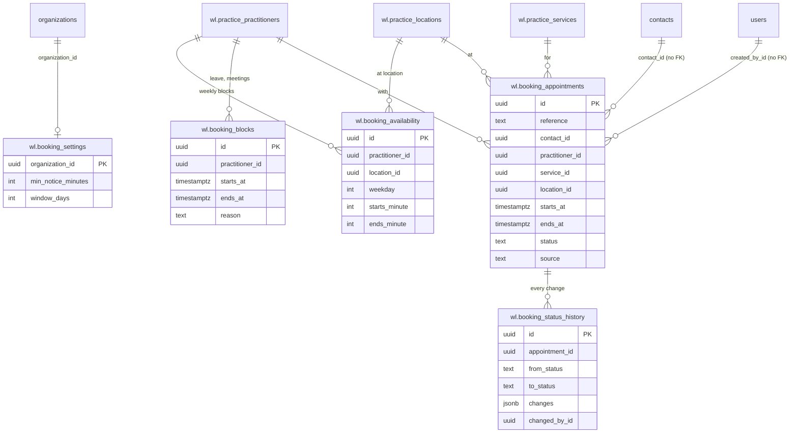
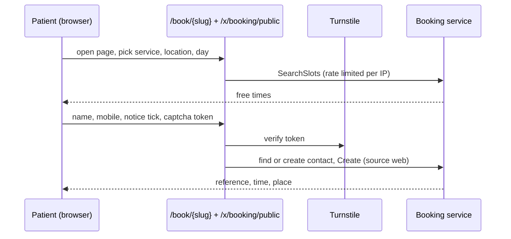
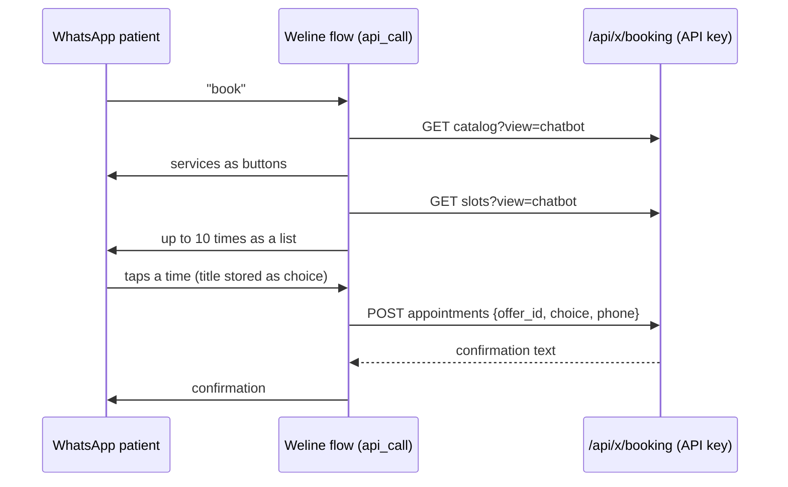

# Booking: design

Requirements: [`requirements.md`](requirements.md). API: [`api.md`](api.md). Builds on
[Practice](../practice/design.md), which it reads through the practice Go service and references by composite keys.

## Data model

Five tables in the `wl` schema, created by `booking/0001_create_booking` (one migration with a `Down` that drops
them in reverse order, plus `CREATE EXTENSION IF NOT EXISTS btree_gist`, which the `Down` leaves in place because
other tables may use it). Every table has `organization_id`. As in Practice, child tables reference parents through
**composite foreign keys on `(organization_id, id)`**, including the Practice tables they depend on, so the database
refuses a booking against another organization's practitioner, service or location. The booking module therefore
migrates after Practice (registry order) and lists it as a dependency.

Weline tables are linked by id only, with no foreign key: `contact_id` → `contacts.id`, `created_by_id` and
`changed_by_id` → `users.id`.

| Table | Columns | Constraints |
| --- | --- | --- |
| `wl.booking_settings` | `organization_id` (PK), `min_notice_minutes` (default 120), `window_days` (default 60), timestamps | `CHECK min_notice_minutes BETWEEN 0 AND 10080`; `CHECK window_days BETWEEN 1 AND 365`; no row = defaults |
| `wl.booking_availability` | `id`, `organization_id`, `practitioner_id`, `location_id`, `weekday` (1–7), `starts_minute`, `ends_minute` (minutes after local midnight) | FK `(organization_id, practitioner_id)` → practitioners, FK `(organization_id, location_id)` → locations, both `ON DELETE CASCADE`; `CHECK ends_minute > starts_minute`; `EXCLUDE` overlapping blocks for the same practitioner and weekday (`int4range`); the practitioner must work at the location (checked in the service) |
| `wl.booking_blocks` | `id`, `organization_id`, `practitioner_id`, `starts_at`, `ends_at` (`timestamptz`), `reason`, `created_by_id`, `created_at` | FK `(organization_id, practitioner_id)`; `CHECK ends_at > starts_at`; index `(organization_id, practitioner_id, starts_at)` |
| `wl.booking_appointments` | `id`, `organization_id`, `reference` (8 chars), `contact_id`, `practitioner_id`, `service_id`, `location_id`, `starts_at`, `ends_at`, `status`, `source`, `note` (≤ 280), `outside_hours` (bool), `created_by_id` (nullable), timestamps | `UNIQUE (organization_id, id)`; `UNIQUE (organization_id, reference)`; composite FKs to practitioner, service, location (no cascade: practice rows are never deleted); `CHECK status IN (…)`, `CHECK source IN ('staff','web','whatsapp','cliniko')`, `CHECK ends_at > starts_at`; **`EXCLUDE USING gist (practitioner_id WITH =, tstzrange(starts_at, ends_at, '[)') WITH &&) WHERE (status <> 'CANCELLED')`**; indexes `(organization_id, starts_at)`, `(organization_id, contact_id, starts_at)` |
| `wl.booking_status_history` | `id`, `organization_id`, `appointment_id`, `from_status` (null on create), `to_status`, `changes` (`jsonb`: moved fields, old → new), `changed_by_id` (nullable), `source`, `reason`, `created_at` | FK `(organization_id, appointment_id)` → appointments; append-only (no update or delete in the service) |

Status values: `BOOKED`, `CONFIRMED`, `ARRIVED`, `COMPLETED`, `CANCELLED`, `NO_SHOW`. `NO_SHOW` and `COMPLETED`
still occupy the time (they happened); only `CANCELLED` frees it.

**Retention (Q10):** appointments and their history are kept 7 years after `starts_at`, then deleted by a job built
before real patient data arrives. Nothing else in this module holds patient data.

**Legacy prototype (R22):** `public.booking_appointments` (from `internal/booking`) has a different schema and no
real data. It is not touched by any migration; the release notes give the `DROP TABLE` for an admin to run.



## Slot search (R4–R6)

For a service S at location L over local dates D1..Dn (clipped to now + minimum notice and to the booking window):

1. Candidates: active practitioners who work at L and whose role is in S's allowed roles (case-insensitive), or the
   one practitioner asked for.
2. For each local date and candidate, free intervals = location opening hours for that weekday ∩ the
   practitioner's availability blocks at L for that weekday, minus closures for L or all locations, minus the
   practitioner's blocks, minus their non-cancelled appointments (at any location).
3. Local wall-clock intervals become instants with the clinic's `time.Location`; a wall-clock time that doesn't
   exist (the skipped hour in October) is skipped, and the repeated hour in April is offered once.
4. Start times step along the slot grid (multiples of `slot_minutes` from local midnight); a start is free if
   `[start, start + duration)` lies inside one free interval.
5. "Anyone" merges candidates: each start time once, with the list of practitioners free then (stable order by
   display name). Results are capped (default 200; 10 for the chatbot view).

Everything is loaded in four queries (availability, blocks, appointments, closures for the range) and computed in
memory; no query per slot. The same function backs staff search, the public page, the chatbot and the re-check on
create and move.

**Creating** runs in one transaction: re-check the slot (unless a staff `outside_hours` override, which still
checks clashes), insert, write history. If the exclusion constraint fires (a race), the service returns the same
409 clash error as its own check.

## Patients and contacts (R13, R15, R19)

The patient is always an upstream `contacts` row, linked by `contact_id`; booking stores no name or phone.

- **Staff:** search the org's contacts by name or number (`ILIKE`, limited to 20), or create one (name + mobile).
- **Web:** the mobile is normalised to digits without `+` (`614xxxxxxxx`, the format upstream stores). An existing
  contact in the org with that number is used (most recently active if several, one per WhatsApp account);
  otherwise a contact is created on the org's default outgoing WhatsApp account with the entered name **(Q1)**.
  The page never reveals whether the number was already known.
- **Chatbot:** the contact is looked up from `{{phone_number}}` in the org; the flow runs inside a conversation, so
  it exists. No match → 404 with a message the flow can show.

Contacts are created through a small writer in the module (`models.Contact` with organization, phone, profile name
and WhatsApp account name). Upstream fires `contact.created` only from its own handlers, so module-created contacts
don't trigger that webhook; nothing in Weline depends on it today.

## Public booking page (R14–R17)

**Why it's served by the module, not the Vue app:** module Vue routes are children of the logged-in layout
(`...moduleRoutes` seam), so a public page there would need a sixth seam in `router/index.ts`. Instead the module
serves `/book/{slug}` itself: one small HTML page (Go `html/template`, embedded, inline CSS and plain JavaScript,
no external scripts except the captcha) that calls the public JSON API. No upstream file changes, no new seam.
**(If you'd rather have a Vue page with the app's look, that needs one more seam line; say so in review.)**

Routes live **outside `/api`** (upstream's auth middleware covers all of `/api`), like the hooks receiver:
`GET /book/{slug}` and `/x/booking/public/{slug}/…`. They are registered before the SPA catch-all.

- **Rate limits** use upstream's `middleware.RateLimit` (Redis, fixed window, honours `trust_proxy`): clinic info
  and slots 60 per minute per IP; booking 5 per hour per IP and 3 per day per mobile.
- **Captcha:** Cloudflare Turnstile **(Q3)**. The widget token is verified server-side against
  `challenges.cloudflare.com/turnstile/v0/siteverify` with the secret from config (`WELINE_TURNSTILE_SITE_KEY`,
  `WELINE_TURNSTILE_SECRET`, set in Render). With no secret configured the public **booking** endpoint refuses
  (503 "online booking isn't set up") so it can't run unprotected; development can set a test key pair.
- **CSRF:** the page calls the API with `credentials: 'omit'`, so a logged-in staff browser's cookies never ride
  along (upstream's CSRF check only applies to cookie-authenticated requests).
- **What it returns:** clinic name and time zone; active locations (id, name, address); active services (id, name,
  duration, price); practitioners (id, display name, role). Slots carry a start instant and the practitioner ids
  free then. The booking response is the reference, local time, location and practitioner name. No contact data,
  no other bookings.
- **Collection notice (R17):** fixed text naming the clinic, the purpose (to book and manage this appointment and
  contact you about it), that details are stored in Weline (hosted by the clinic's provider) and may be used to
  message the patient on WhatsApp, with a link to the clinic's website from its Practice profile. The patient must
  tick it to submit.

## WhatsApp chatbot (R18, R19)

A chatbot `api_call` node authenticates with an API key (header `X-API-Key`) of a user in the clinic's org; the
key's rights are its user's, so the guide recommends a dedicated "WhatsApp bot" user with a role holding only
`wl_booking_appointments:read,create`. Calls go through Weline's SSRF-safe client, so they use the public URL
(`WELINE_PUBLIC_URL`), never localhost.

Constraints from Weline's flow engine (`internal/handlers/chatbot_graph_runner.go`): button **titles** are
templated but **ids are not**, empty-title buttons are skipped, at most 10 buttons (more than 3 become a list), a
list row title is at most 24 characters, and a tapped button stores its **title** in `store_as`. So:

- `GET /api/x/booking/catalog?view=chatbot` returns `service_1_label` … `service_N_label` (N ≤ 10) and an
  `offer_id`.
- `GET /api/x/booking/slots?view=chatbot&service=…` (or `service_label` + `offer_id` from the catalog) returns up to
  10 options as `slot_1_label` … `slot_10_label` (unique, ≤ 24 characters, e.g. `Tue 11 Nov 10:15 Dr Lee`), the
  count, and an `offer_id`. The offer (the labels and the slots behind them) is kept in Redis for 30 minutes under
  the org.
- The flow's buttons node has fixed ids `slot_1`…`slot_10` with titles `{{slot_1_label}}`…; fewer slots simply
  show fewer rows.
- `POST /api/x/booking/appointments` with `{ offer_id, choice: "{{choice}}", phone: "{{phone_number}}" }` books
  the chosen slot (re-checked), and returns `confirmation` text for the next message node. An expired offer or a
  slot taken meanwhile returns 409 with a message the flow can show before offering times again.

The full step-by-step flow guide (`chatbot-flow.md`) is written after prompt B, when the endpoints exist.

## Go service for other modules (R23)

```go
SearchSlots(ctx, orgID, SlotQuery) ([]Slot, error)
Create(ctx, orgID, actor Actor, NewAppointment) (*Appointment, error)        // re-checks, writes history
Move(ctx, orgID, actor, id, MoveInput) (*Appointment, error)                  // BOOKED/CONFIRMED only
SetStatus(ctx, orgID, actor, id, to Status, reason string) (*Appointment, error)
Get(ctx, orgID, id) (*Appointment, error)
List(ctx, orgID, ListQuery) ([]Appointment, error)                            // by range, practitioner, contact, status
```

`Actor` is `{UserID *uuid.UUID; Source string}`, so Reminders can confirm (`CONFIRMED`, source `whatsapp`) and
Calendar can move (staff user) with the right history.

## Screens

A sidebar section **Bookings** with three pages under `/x/booking/` (staff, logged in):

| Page | Content | States |
| --- | --- | --- |
| **Appointments** `/x/booking/appointments` | Date picker (today by default) and practitioner filter; list of the day's appointments with time, patient, service, practitioner, location, status badge and reference; actions per row by allowed transition (Confirm, Arrived, Completed, No-show, Cancel with reason, Move); history drawer. **New appointment** dialog: service → location → practitioner or anyone → date → free times → patient search or new patient → note → book. | loading · empty day · error · forbidden · read-only (no actions) |
| **Availability** `/x/booking/availability` | Practitioner picker; weekly grid per location of working blocks (add, edit, remove; times on the slot grid, clipped hint where outside opening hours); blocks list with add (from/to, reason) and remove; booking settings (minimum notice, window) | loading · no practitioners (link to Practice) · error · forbidden · read-only |
| **Online booking** `/x/booking/online` | The clinic's booking link (copy), whether online booking is ready (profile, a service, availability, captcha configured), and a preview link | loading · not ready (lists what's missing) · forbidden |

Plus the public page `/book/{slug}` (no login): service → location → practitioner (optional) → day → time → name,
mobile, notice tick, captcha → reference.

## Flows





## WhatsApp templates

None in this slice. The chatbot confirmation is a free-form reply inside the patient's open 24-hour window. Web
bookings send nothing (Q9); the confirmation and reminder templates arrive with Phase 2 and must be submitted to
Meta at the Phase 1 gate.

## Threats

New entry points, data and integrations this module adds, and how each is protected. Folded into
[`../../threat-model.md`](../../threat-model.md) by prompt C.

| Threat | Protection |
| --- | --- |
| **Public endpoints (new, unauthenticated):** fake or spam bookings filling a clinic's diary | Turnstile verified server-side on every booking; rate limits per IP and per mobile; booking refused when captcha isn't configured; staff can cancel; bookings carry source `web` so they can be reviewed. **Open risk:** a determined attacker with many IPs and numbers can still book; monitor and add phone verification (WhatsApp OTP) if abused. |
| **Public endpoints: information disclosure** (other patients' bookings, internal ids, staff details) | Responses limited to clinic name, locations, services, practitioner display names and roles, and free start times; no contact data, no appointment ids except the caller's own reference; same response whether the mobile was known or not. |
| **Slug enumeration** (finding which clinics use Weline) | Slugs are public by design (shared links); unknown slug and inactive clinic return the same 404; rate limited. |
| **Cross-organization access** (booking against another clinic's practitioner, reading its diary) | Staff routes behind `kit.Guard` in the active org; every query filtered by `orgID`; composite FKs into Practice tables refuse cross-org rows in the database; public routes resolve the org only from the slug. Tested with a second organization. |
| **Double booking under concurrency** | Service check plus the Postgres exclusion constraint; constraint violation mapped to 409. Tested with parallel requests. |
| **Tampering with the slot or price** (public or chatbot) | The server re-computes the slot from its own data on create; the client sends only ids and a start instant (or an offer id + choice); duration and end come from the service. Price is display only. |
| **Chatbot API key misuse** | Key belongs to a dedicated low-permission user (guide); key sits in the flow config (threat model open risk 4). The chatbot can only book for the phone number of the conversation's contact (`{{phone_number}}`) in the key's org. |
| **New patient data:** appointments (who, when, where, which service) and notes | Administrative only; note limited to 280 characters with a "no clinical details" hint; never logged; retention rule (7 years, Q10); history append-only. Hosting region must be Australian before real patients (threat model open risk 6). |
| **Contacts created from the public page** (junk contacts, someone else's number) | Captcha and per-mobile limits; contact created only on a successful booking; staff see source `web`. **Open risk:** a person can book under someone else's mobile; the clinic confirms on arrival. |
| **Privilege escalation:** reception changing availability, anyone deleting history | Availability needs `wl_booking_availability:update` (managers by default); appointments are never deleted; history has no update or delete path. |
| **No audit of who viewed appointments** | Open: reads aren't logged (threat model open risk 7). Changes are recorded in `wl.booking_status_history`. |
| **Captcha secret** | Only in Render's environment, never in `render.yaml`, logs or responses; verified over HTTPS with a timeout. |
