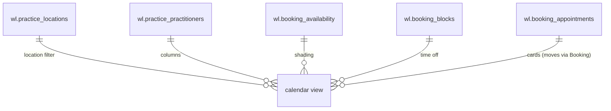
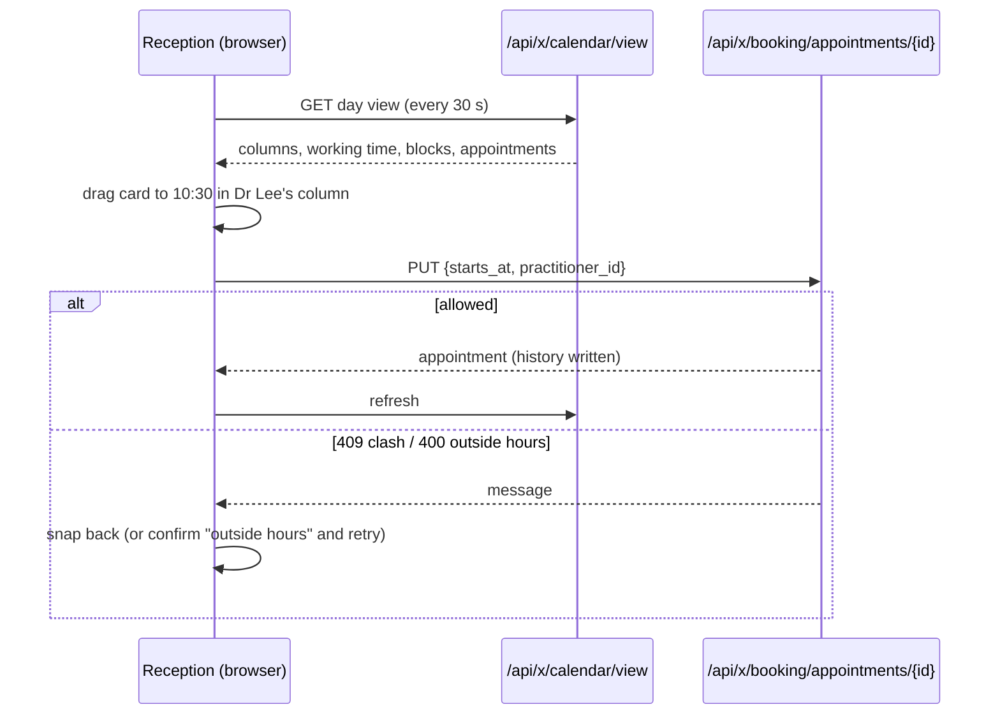

# Calendar: design

Requirements: [`requirements.md`](requirements.md). API: [`api.md`](api.md). Reads [Practice](../practice/design.md)
and [Booking](../booking/design.md) through their Go services; changes go through Booking.

## Data model

**No tables.** Calendar is a view: it reads Practice (time zone, slot grid, locations, opening hours, closures,
practitioners) and Booking (availability, time off, appointments) through their Go services, and writes only through
Booking's service, so every booking rule and the status history stay in one place. It has **no migration**: the
registry seeds every module's permissions from its `Permissions()` list (`wl_calendar_view`) after running migrations.

`wl.calendar_views` (saved filters) from the SDLC entry is out of scope for this slice.

### Change to Booking (R8)

Booking's `Move` gains an optional new **end** for staff: `MoveInput.EndsAt`. Rules: whole slots on the grid, at
least one slot, at most 8 hours, end after start; same re-checks as a move (hours and availability unless outside
hours, clashes always, the patient's other appointments); history records `ends_at` old → new. When only `starts_at`
changes, the duration is kept (today's behaviour). `PUT /api/x/booking/appointments/{id}` accepts `ends_at`. No schema
change: `ends_at` already exists.

## Backend (`internal/modules/calendar`)

A small module with one read endpoint (R16) and its permission (`wl_calendar_view: read`; admin, manager, agent).

`GET /api/x/calendar/view?view=day|week&date=YYYY-MM-DD&location_id=&practitioner_id=…` builds, for the range:

1. Clinic: time zone, slot length, today's date in the clinic's zone.
2. Columns: active practitioners at the location (day) or the one practitioner (week), with whether each is linked to
   the caller's Weline login (for "Just me").
3. Per column and day, local minute ranges: opening hours ∩ the practitioner's availability (**working**), time off
   (**blocks**, clipped to the day, with reason), and whether the location is closed (with the closure reason).
4. Appointments starting in the range for those practitioners (any location, so a practitioner's time elsewhere still
   shows as busy, labelled with that location), as Booking presents them (patient name, service, status, allowed
   next statuses, reference).
5. The visible time range: min(opening, working, appointments) to max(…), on the grid.

It uses existing service calls (`practice.OpeningMinutes`, `ClosedDays`, `ActivePractitioners`; `booking.List`, plus a
new read-only `booking.WorkingRanges(ctx, org, practitionerIDs, from, to)` that returns availability and blocks in
the same shape the slot engine uses). One round trip, a handful of queries, no per-practitioner requests.

Daylight saving: minutes are local wall-clock; on the October change the 02:00–03:00 rows don't exist and are omitted;
in April the repeated hour is drawn once (appointment cards are placed by their local start and end).

## Frontend (`frontend/src/modules/calendar`)

One page `/x/calendar` with a toolbar (date, Today, previous/next, Day | Week, location, practitioner filter, "Show
cancelled") and the grid. No new npm packages: the grid is CSS grid plus pointer events in our own components.

| Component | Job |
| --- | --- |
| `CalendarGrid.vue` | Time gutter, one column per practitioner (day) or per day (week), row height per slot, shading for non-working time and blocks, the now line (updates every minute), cards. Cards in one column that overlap are laid out side by side. |
| `AppointmentCard.vue` | Status colour, time, patient, service; focusable; drag handle (move) and bottom edge (resize). |
| `useDragMove.ts` | Pointer-event drag with snapping to the grid; previews the new time and column; on drop calls Booking's `PUT` with `starts_at` (+ `practitioner_id` across columns, + `ends_at` when resizing). On a 400 "isn't available" asks "Book outside hours?" and retries with `outside_hours`; on 409 snaps back and shows the message. Escape cancels a drag. |
| `AppointmentPanel.vue` | Side sheet: details, status actions, history, Move via time picker (keyboard alternative to drag), links to `/chat/<contact_id>` (permission `chat`) and `/settings/contacts/<contact_id>` (permission `contacts`). |
| Empty-slot click | Opens Booking's `NewAppointmentDialog` (reused from the booking module) with the practitioner, date and time filled in; the service is chosen in the dialog, and the times shown there still come from Booking's free-slot search. |

Store `useCalendarStore`: the view payload, loading/error/forbidden, a 30 s refresh timer paused while dragging or when
the tab is hidden, and optimistic placement during a drag (reverted on refusal). The location and "Just me" choices
are kept in `localStorage` (per browser, not per user).

Week view "all practitioners": a table of day × practitioner with appointment counts and free-slot hints; clicking a
cell opens that day.

Status colours (shared with Booking's badges): Booked outline, Confirmed blue, Arrived green, Completed grey,
No-show red, Cancelled red striped (hidden unless "Show cancelled").

## Screens

| Page | Content | States |
| --- | --- | --- |
| **Calendar** `/x/calendar` (sidebar: Bookings → Calendar) | Toolbar; day grid (practitioner columns) or week grid; side panel; New appointment from a slot | loading (skeleton grid) · empty (no practitioners at the location: link to Practice) · closed day · error with retry · forbidden · read-only (no drag, no slot booking, no actions) |

## Flows

## WhatsApp templates

None. Moving an appointment doesn't message the patient in this slice; the reschedule template arrives with
Reminders (Phase 2).

## Threats

New entry points, data and integrations this module adds, and how each is protected. Folded into
[`../../threat-model.md`](../../threat-model.md) by prompt C.

| Threat | Protection |
| --- | --- |
| **Cross-organization reads** through the view endpoint | `kit.Guard` with `wl_calendar_view` in the active org; every service call takes `orgID`; location and practitioner ids from the query are looked up inside the org (404 otherwise). Tested with a second organization. |
| **Changes without the right permission** (drag by a read-only user) | The UI hides drag and actions without `wl_booking_appointments` update, and the server is the authority: moves go through Booking's guarded `PUT`, which refuses without the permission. |
| **Unsafe moves** (double booking, outside hours by accident, moving a finished appointment) | All checks stay in Booking (grid, hours, availability, time off, clashes, patient overlap, movable statuses, exclusion constraint); outside-hours needs an explicit confirmation and is recorded. |
| **Patient data on screen** (names on a shared reception screen) | Same data and permission as the Appointments list; no new data. Phone numbers only in the side panel, not on cards. Not logged. |
| **Data volume / scraping** | Range limited to a day or a week; one location or practitioner; read-only endpoint behind login. |
| **Stale views causing double work** (two receptionists move the same appointment) | Booking re-checks on every change; the loser gets a clash or "not movable" message and the view refreshes. |
