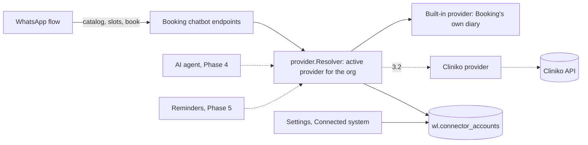
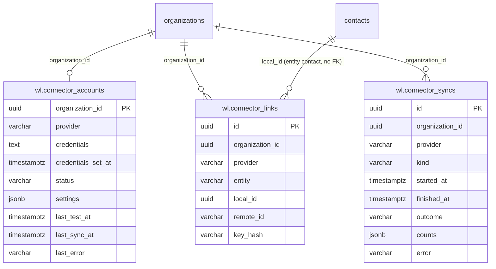

# Connectors: design

Requirements: [`requirements.md`](requirements.md). API: [`api.md`](api.md). Cliniko: [`cliniko-spike.md`](cliniko-spike.md).

## How it fits Weline



### Packages (no import cycle)

| Package | Holds | Imports |
| --- | --- | --- |
| `internal/modules/connectors/provider` | The interface (`Provider`), its types, typed errors, `Resolver` and `Consumer` interfaces. No database, no module | kit only |
| `internal/modules/booking` | `booking.BuiltIn`: implements `provider.Provider` on Booking's service. The chatbot endpoints call a `provider.Resolver` | `provider` |
| `internal/modules/connectors` | The module: tables, settings API, the resolver that picks the provider per organization, connection tests, sync log | `provider`, `booking` (to build the built-in provider) |
| `internal/modules/connectors/cliniko` (3.2) | The Cliniko provider | `provider` |

**Wiring:** the registry (Weline-owned `internal/modules/registry.go`) already passes event handlers to the hooks
receiver. It also gives every module that implements `provider.Consumer` the resolver from the module that implements
`provider.Source` (Connectors). Without Connectors, Booking falls back to its own built-in provider, so its tests stand
alone.

## The interface

```go
package provider

type Provider interface {
    Name() string                    // "builtin", "cliniko"
    Abilities() Abilities            // which calls are supported
    ListLocations(ctx) ([]Location, error)
    ListPractitioners(ctx, locationID string) ([]Practitioner, error)   // "" = all
    ListServices(ctx) ([]Service, error)
    FindFreeTimes(ctx, FreeTimeQuery) ([]FreeTime, error)
    FindOrCreateCustomer(ctx, CustomerInput) (*Customer, bool, error)    // created?
    Book(ctx, BookInput) (*Appointment, error)
    Reschedule(ctx, id string, RescheduleInput) (*Appointment, error)
    Cancel(ctx, id string, reason string) error
    GetAppointment(ctx, id string) (*Appointment, error)
    ListAppointments(ctx, AppointmentQuery) ([]Appointment, error)       // changed since, or a time range
}

type Resolver interface {
    For(ctx, orgID uuid.UUID) (Provider, error)   // the org's active provider, bound to the org
}
```

- A provider value is **bound to one organization** (the resolver builds it with the org id and its credentials), so
  calls don't take `orgID` and can't mix organizations.
- Ids are strings (`Location.ID`, `Practitioner.ID`, …). Times are `time.Time` in UTC. `Service.Minutes` is the
  duration.
- `FreeTimeQuery{ServiceID, LocationID, PractitionerID (optional), From, To, Limit}` returns `FreeTime{Start, End,
  PractitionerID, PractitionerName, LocationID}` sorted by start.
- `CustomerInput{ContactID uuid (Weline contact), Name, Mobile}`. The built-in provider's customer is the Weline contact
  itself; Cliniko's is a patient linked to the contact in `wl.connector_links`.
- `BookInput{ServiceID, LocationID, PractitionerID, Start, CustomerID, ContactID, Note, Source}`.
- Errors: `provider.ErrNotFound`, `ErrSlotTaken`, `ErrInvalid`, `ErrNotSupported`, `ErrNotConnected`,
  `ErrUnavailable`, and `*RateLimited{RetryAt}`, all mappable to `kit` errors for HTTP answers.

### Built-in provider

`booking.BuiltIn{svc, practice, orgID}` maps each call onto what Booking already does:

| Ability | Booking call |
| --- | --- |
| ListLocations / ListPractitioners / ListServices | `practice.ActiveLocations`, `ActivePractitioners`, `ActiveServices` |
| FindFreeTimes | `Service.SearchSlots` |
| FindOrCreateCustomer | `Service.FindOrCreatePatient` (a Weline contact) |
| Book | `Service.Create` with source `whatsapp` |
| Reschedule | `Service.Move` |
| Cancel | `Service.SetStatus(CANCELLED)` |
| GetAppointment / ListAppointments | `Service.Get` / `Service.List` |

The chatbot endpoints keep their offers in Redis as now, but each offer item stores provider ids as strings and the
provider name, so an offer made with one provider is refused (409, "choose again") if the clinic switches provider
before the patient taps.

## Data model

All tables in schema `wl`, every row carries `organization_id`, all times UTC.

| Table | Columns | Notes |
| --- | --- | --- |
| `wl.connector_accounts` | `organization_id` PK, `provider` varchar(20) (`builtin`, `cliniko`), `credentials` text (encrypted with Weline's `encryption_key`, `''` for built-in), `credentials_set_at`, `status` varchar(12) (`connected`, `error`, `not_set_up`), `settings` jsonb (provider options, no secrets), `last_test_at`, `last_sync_at`, `last_error` varchar(300), `updated_by_id`, `created_at`, `updated_at` | One row per organization; no row = built-in |
| `wl.connector_links` | `id`, `organization_id`, `provider`, `entity` varchar(20) (`contact`, `appointment`, `phone`), `local_id` uuid (null for `phone`), `remote_id` varchar(64), `key_hash` varchar(64) (SHA-256 of a normalised mobile for `phone`), `created_at`, `updated_at` | `UNIQUE (organization_id, provider, entity, local_id)` where `local_id` is set; `UNIQUE (organization_id, provider, entity, remote_id)`; index `(organization_id, provider, key_hash)` |
| `wl.connector_syncs` | `id`, `organization_id`, `provider`, `kind` varchar(12) (`test`, `sync`), `started_at`, `finished_at`, `outcome` varchar(10) (`ok`, `error`), `counts` jsonb, `error` varchar(300) | Append-only; the last 100 per organization kept (older ones deleted after each insert) |

`local_id` links upstream `contacts` or `wl.booking_appointments` by id (no FK, as in other modules).



Permissions are seeded by the migration (R12).

## Settings flow

1. `GET /api/x/connectors/account` shows the active provider (built-in when there's no row), its status and the list
   of available providers with the credential fields each needs.
2. `PUT /api/x/connectors/account` with `{provider, credentials?, settings?}`:
   - built-in: saves `provider = builtin`, clears credentials;
   - another provider: requires credentials (or keeps the stored ones when omitted and the provider is unchanged),
     runs the provider's connection test, and saves only if it passes; the result is logged in `connector_syncs`.
3. `POST /api/x/connectors/account/test` re-tests the stored credentials and updates the status.

Until 3.2 the only provider listed is built-in; the screen shows Cliniko as "coming soon".

## Screens

| Page | Content | States |
| --- | --- | --- |
| **Connected system** `/x/connectors` (sidebar: Settings area, "Connected system") | Current system and status badge; choose system (cards); credentials form for the chosen one with Test connection; last test and sync; recent log entries; switching note | loading · error · forbidden · read-only (no form) |

## WhatsApp templates

None.

## Threats

| Threat | Protection |
| --- | --- |
| **Credential theft** (a Cliniko key opens a clinic's patient records) | Encrypted at rest with Weline's key (`internal/crypto`); never returned by the API, never logged, never in errors; only `update` holders (admins) can set them; who set them and when is recorded. Open risk: anyone with the database and the app's encryption key can decrypt. |
| **Cross-organization use** | The resolver builds a provider bound to one organization's row; every query filtered by `organization_id`; tested with a second organization. |
| **A slow or failing provider breaking WhatsApp** | 10-second timeouts; typed errors turned into the flow's error branch ("booking unavailable"); status and last error shown to the manager. |
| **Duplicate patients in the clinic's system** | Links reuse a known patient; phone hashes find existing ones without a phone search (Cliniko); creates are logged. |
| **Patient data in logs** | The sync log stores counts and error messages only; provider error bodies are reduced to a status and a short message without patient fields. |
| **Stale offers after switching provider** | Offers carry the provider name and are refused after a switch. |

**Open risks:** credentials can be decrypted by anyone holding both the database and `encryption_key` (same as WhatsApp
tokens today); the audit trail for credential access comes in step 3.3.
