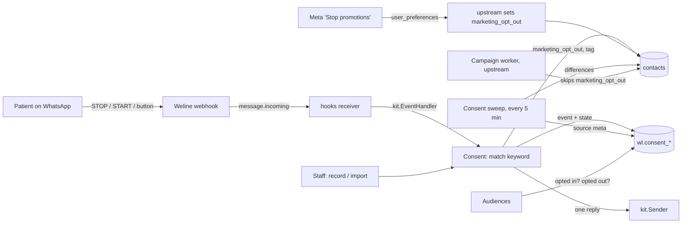
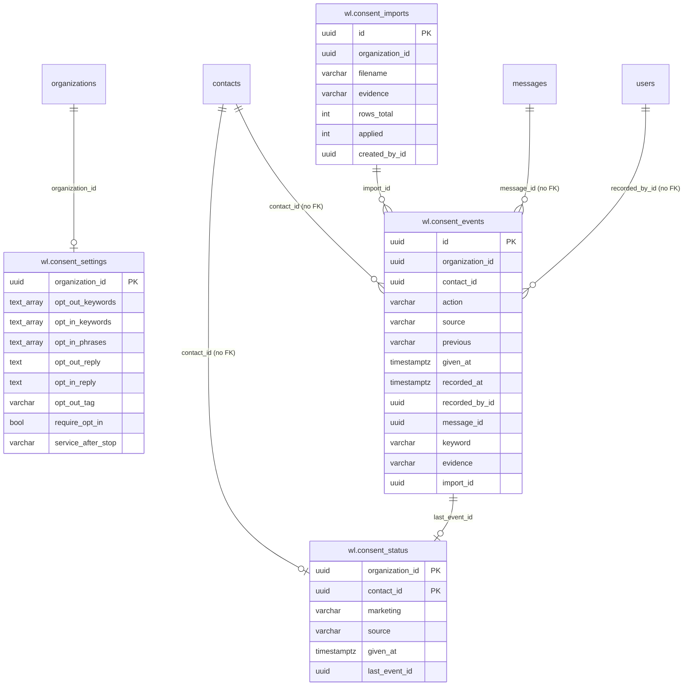

# Consent: design

Requirements: [`requirements.md`](requirements.md). API: [`api.md`](api.md).

## How it fits Weline



- **Source of truth for sending:** upstream's `contacts.marketing_opt_out`. Upstream's campaign worker and template
  send already honour it.
- **What Consent adds:** the **opt-in** state, the **history**, and the keyword handling.
- **Upstream code is untouched.** The module updates `marketing_opt_out` and `tags` on `contacts` through upstream's
  `models.Contact`, like Weline's own handlers.

## Data model

All tables in schema `wl`, every row carries `organization_id`, all times UTC.

| Table | Columns | Notes |
| --- | --- | --- |
| `wl.consent_settings` | `organization_id` PK, `opt_out_keywords` text[], `opt_in_keywords` text[], `opt_in_phrases` text[], `opt_out_reply` text, `opt_in_reply` text, `opt_out_tag` varchar(50), `require_opt_in` bool (R9, default false), `service_after_stop` varchar(10) `continue`/`stop` (R10, default `continue`), `updated_by_id`, `updated_at` | No row = defaults (see requirements R1, R3, R5). Keywords stored upper-case, normalised; at most 30 per list, 50 characters each |
| `wl.consent_status` | `organization_id`, `contact_id` (PK together), `marketing` varchar(10) `opted_in`/`opted_out`, `source`, `given_at`, `last_event_id`, `updated_at` | One row per contact whose consent is known. No row = **not recorded**. `opted_out` always matches `contacts.marketing_opt_out = true`; the sweep repairs any difference |
| `wl.consent_events` | `id`, `organization_id`, `contact_id`, `action` `opt_in`/`opt_out`, `source` `keyword`/`button`/`staff`/`import`/`meta`/`ad`/`web_form`, `previous` (`opted_in`/`opted_out`/null), `given_at` (when the person gave it), `recorded_at`, `recorded_by_id` (staff and imports), `message_id` (upstream `messages.id` for keyword and button), `keyword` (the matched keyword, never the full text), `evidence` varchar(500), `import_id` | **Append-only**: the module has no update or delete for events (enforced in code, tests and review). Index `(organization_id, recorded_at DESC)` and `(organization_id, contact_id, recorded_at DESC)` |
| `wl.consent_imports` | `id`, `organization_id`, `filename`, `evidence` varchar(1000), `rows_total`, `applied`, `skipped_unknown`, `skipped_invalid`, `skipped_opted_out_later`, `created_by_id`, `created_at` | One row per applied CSV. The file itself isn't stored |

Composite key `(organization_id, id)` on imports and events, and `(organization_id, last_event_id)` and
`(organization_id, import_id)` reference them, so rows can't point across organizations. `contact_id` links upstream
`contacts` by id (no FK, as in other modules).



Permissions are seeded by the migration (R14).

## Changing state (one function for every source)

`Service.Apply(ctx, orgID, contactID, change)` with `change = {action, source, given_at, evidence, keyword,
message_id, recorded_by, import_id}`. In one transaction:

1. Lock the contact's status row (`SELECT … FOR UPDATE`, or insert).
2. If the state is already the target, record nothing and return `changed=false`.
   - Exception: a staff or import opt-in with evidence on an `opted_in` contact adds an event without changing
     state, to keep the proof.
3. Imports only: if the contact has an opt-out **later** than the row's `given_at`, skip the row (R7).
4. Insert the event and upsert the status.
5. Update `contacts`:
   - `marketing_opt_out` (true for opt-out, false for opt-in);
   - add or remove the opt-out tag in `tags`, de-duplicated.

   Both go through `models.Contact` filtered by `organization_id`.

After the commit, a keyword or button change with `changed=true` sends the confirmation reply through
`kit.Sender.SendText`. The conversation was just opened by the patient, so it's inside the 24-hour window. A failed
reply is logged without phone or text and doesn't undo the change.

## Keyword matching (R1, R5)

```
normalise(s) = upper(trim(collapse_spaces(strip(s, punctuation and emoji))))
```

- Applies to `message.incoming` events with `message_type` text, or interactive/button replies, where `content` is
  the button title.
- Opt-out keywords are checked first, then opt-in keywords, then opt-in phrases (phrases compared after the same
  normalisation).
- The whole message must equal a list entry. Messages longer than 60 characters are skipped without matching.
- Event handling must be quick: one indexed settings read (cached 60 s in memory per org), at most one transaction,
  and one send.

## Meta's signal (R4): the sweep

Upstream's `user_preferences` handler updates `contacts.marketing_opt_out` without an event. Consent runs a sweep
every 5 minutes (a goroutine started in `Register`, with a Redis lock `wl:consent:sweep` so only one instance runs).
The sweep finds contacts where the two disagree:

- `marketing_opt_out = true` and the status is not `opted_out` → `Apply(opt_out, source meta, given_at = now)`;
- `marketing_opt_out = false` and the status is `opted_out` → `Apply(opt_in, source meta)` (Meta "resume").

It's one indexed query per organization, in batches of 500. The time recorded is when the sweep saw the change, at
most 5 minutes late. The status table means the sweep never re-records a change it already saw.

## Checks for other modules (R9, R10)

```go
// Allowed reports whether a module may send this kind of message to the contact now.
func (s *Service) Allowed(ctx context.Context, orgID, contactID uuid.UUID, purpose Purpose) (bool, Reason, error)
```

| Purpose | Allowed when |
| --- | --- |
| `marketing` | not opted out, and (`require_opt_in` off, or status `opted_in`) |
| `service` | not (`opted_out` and `service_after_stop = stop`) |

Audiences (2.2 B):
- reads `consent_status` in its rules: a new `consent` field with ops `opted_in`, `opted_out`, `not_recorded`;
- adds the exclusion `no_opt_in` for marketing templates when `require_opt_in` is on;
- reports `not_recorded` in its preview.

Reminders (Phase 5) will call `Allowed(service)`.

## Screens

| Page | Content | States |
| --- | --- | --- |
| **Consent** `/x/consent` (sidebar: its own Consent section with Consent and Settings) | Counts (opted in, opted out, not recorded); history table (when, contact name and masked number, action, source, evidence, by); filters | loading · empty · error · forbidden |
| **Contact consent** (dialog from the page) | Find a contact (POST search, as in Booking); current state and its history; "Record opt-in" (date, required note) / "Record opt-out" (date, optional note) | read-only without `records:create` |
| **Import opt-ins** (dialog) | Upload CSV → preview counts → proof description → confirm with count | blocks on 0 rows to apply |
| **Consent settings** `/x/consent/settings` | Keyword and phrase lists (chips), reply texts with a preview, tag, "Marketing only to people who opted in", service policy; note about "Reply STOP" in template footers and about campaigns created outside Audiences | read-only without `settings:update` |

## WhatsApp templates

None. The two confirmations are free-form replies inside the 24-hour window the patient's message opens. Marketing
templates should carry "Reply STOP to opt out" in their footer; that's the business's own template, and the settings
page says so.

## Threats

| Threat | Protection |
| --- | --- |
| **Forged opt-outs or opt-ins** (someone faking a STOP or START for another person) | Only messages that arrive through Weline's webhook from the contact's own number count (verified hooks receiver: per-org token, HMAC when present). Staff changes need `wl_consent_records:create` and are recorded with the user. Open risk: the receiver's signature gap (threat model risk 1). |
| **Losing an opt-out** (a STOP not applied, then marketing sent) | Applied inside the event handler before returning; upstream's worker checks the flag at send time; the sweep repairs any difference between the flag and our status; idempotent handling makes retries safe. |
| **Wrong opt-out on an ordinary message** | Whole-message match after normalisation; CANCEL excluded; long messages skipped; editable lists. |
| **Tampering with proof** | Events are append-only in the app (no update or delete routes); evidence and the user who recorded it kept; imports keep the proof description. |
| **Cross-organization changes** | Every query filters by `organization_id`; contact ids resolved inside the org (404 otherwise); composite keys; tested with a second organization. |
| **Personal data in logs or history** | Only the matched keyword is stored, never the message; no phone numbers or names logged; the history shows masked numbers. |
| **Reply loops or spam** (confirmation sent repeatedly) | Reply only on a change of state; at most one per event; hooks de-duplicate events. |
| **CSV import abuse** (huge files, formula injection, other orgs' numbers) | 5,000 rows and 1 MB at most; phone numbers matched only to this org's contacts; unknown numbers skipped, never created; cells treated as text (the file isn't stored or exported). |
| **Upstream's chatbot answers STOP too** (greeting, fallback or AI reply after the confirmation) | Open risk: upstream's chatbot runs separately. The settings page suggests a chatbot keyword rule for the same words with no reply. Confirm on staging. |

**Open risks:**
- **Meta changes are recorded late.** They reach the history up to 5 minutes later.
- **Opt-in can't be enforced on campaigns made outside Audiences** (out of scope; see requirements).
