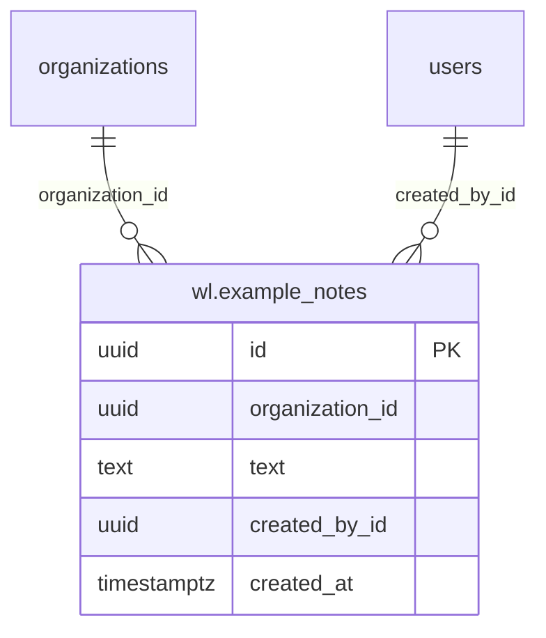

# Example: design

## Data model

One table, `wl.example_notes`, created by migration `example/0001_create_notes`.

| Column | Type | Notes |
| --- | --- | --- |
| id | uuid PK | `gen_random_uuid()` |
| organization_id | uuid not null | links to `organizations.id` by id (no FK into upstream tables); indexed with `created_at DESC` |
| text | text not null | 1–1000 characters, trimmed |
| created_by_id | uuid | links to `users.id` |
| created_at, updated_at, deleted_at | timestamptz | `models.BaseModel` |

## Screens

**Notes** at `/x/example/notes` (sidebar section "Example"):
- loading: skeleton rows
- empty: "No notes yet"
- error: retry
- forbidden (API 403): "No access"
- read-only: the add form is replaced by "You can read notes but don't have permission to add them."

## Flows
Add note: form → `POST /api/x/example/notes` → the note is prepended to the list. A 400 shows the server's message, and a 403 shows the forbidden message.

## WhatsApp templates
None.

## Threats
- New entry points: `GET` and `POST /api/x/example/notes`, both behind Weline login and `kit.Guard`, which checks the permission in the active organization.
- New data: free-text notes, which could contain patient details. Org-scoped in every query, never logged, and never shown in error messages (internal errors become a generic 500).
- No external integrations.
- Open risk: none beyond the general ones in `wl-docs/threat-model.md` (step 0.10).
