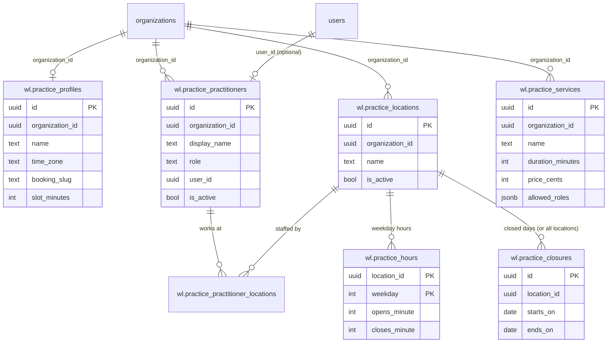

# Practice: design

Requirements: [`requirements.md`](requirements.md). API: [`api.md`](api.md).

## Data model

Seven tables in the `wl` schema, created by `practice/0001_create_practice` (one migration, with a `Down` that drops
them in reverse order). Every table has `organization_id`. Child tables reference parents through
**composite foreign keys on `(organization_id, id)`**, so the database itself refuses to link a row to another
organization's location or practitioner. Weline tables (`organizations`, `users`) are linked by id only (no FK into
upstream tables).

| Table | Columns | Constraints |
| --- | --- | --- |
| `wl.practice_profiles` | `id`, `organization_id`, `name`, `time_zone`, `booking_slug`, `slot_minutes`, `abn`, `phone`, `email`, `website`, timestamps | `UNIQUE (organization_id)`; `UNIQUE (booking_slug)`; `CHECK slot_minutes IN (5,10,15,20,30,60)` |
| `wl.practice_locations` | `id`, `organization_id`, `name`, `address`, `phone`, `is_active`, timestamps | `UNIQUE (organization_id, id)`; `UNIQUE (organization_id, name)` |
| `wl.practice_practitioners` | `id`, `organization_id`, `display_name`, `role`, `ahpra_number`, `user_id` (nullable, → `users.id`), `is_active`, timestamps | `UNIQUE (organization_id, id)`; `UNIQUE (organization_id, user_id) WHERE user_id IS NOT NULL` |
| `wl.practice_practitioner_locations` | `organization_id`, `practitioner_id`, `location_id` | `PRIMARY KEY (practitioner_id, location_id)`; FKs `(organization_id, practitioner_id)` and `(organization_id, location_id)`, `ON DELETE CASCADE` |
| `wl.practice_services` | `id`, `organization_id`, `name`, `duration_minutes`, `price_cents` (nullable), `allowed_roles jsonb` (array of strings), `is_active`, timestamps | `UNIQUE (organization_id, id)`; `UNIQUE (organization_id, name)`; `CHECK duration_minutes BETWEEN 5 AND 480`; `CHECK price_cents >= 0`; `CHECK jsonb_array_length(allowed_roles) >= 1` |
| `wl.practice_hours` | `organization_id`, `location_id`, `weekday` (1 = Monday … 7 = Sunday, ISO), `opens_minute int`, `closes_minute int` (minutes after local midnight, 0–1440) | `PRIMARY KEY (location_id, weekday)`; FK `(organization_id, location_id)`; `CHECK closes_minute > opens_minute`; no row = closed that day |
| `wl.practice_closures` | `id`, `organization_id`, `location_id` (nullable = all locations), `starts_on date`, `ends_on date`, `reason`, timestamps | FK `(organization_id, location_id)`; `CHECK ends_on >= starts_on` |

Index: `(organization_id, is_active)` on locations, practitioners and services; `(organization_id, starts_on)` on
closures.

Rules the database can't express, enforced in the service (`orgID` first on every method):
- a linked `user_id` must be a member of the organization (`user_organizations`, or the user's default org);
- service duration and opening/closing times must sit on the clinic's slot grid; changing the slot length is
  refused while existing services or hours are off the new grid (the error names them);
- `allowed_roles` must be roles that at least one practitioner in the clinic has, or a warning is returned.



### Changes made while building (step 1.1 B)

- `allowed_roles` is `jsonb`, not `text[]`: upstream's pinned GORM has no Postgres array type, and Weline already
  maps `jsonb` string arrays (`models.StringArray`).
- Opening hours are stored as minutes after local midnight instead of `time`: `24:00` (closing at midnight) fits,
  and the slot-grid check is plain arithmetic. The API still speaks `"HH:MM"`.
- Updates are `PUT` with partial bodies, not `PATCH`: Weline's router (fastglue) has no `PATCH`.
- The Go model for a service is `ClinicService`, because `Service` is the module's logic type.
- Added `GET /members` (org members for the practitioner login picker); see [`api.md`](api.md).

## Go service for other modules (R18)

`internal/modules/practice` exports a read service other modules construct with the DB:

```go
GetProfile(ctx, orgID) (*Profile, error)              // ErrNotSetUp until saved (IsNotSetUp(err))
ActiveLocations(ctx, orgID) ([]Location, error)
ActivePractitioners(ctx, orgID) ([]Practitioner, error) // with LocationIDs
ActiveServices(ctx, orgID) ([]ClinicService, error)
IsOpen(ctx, orgID, locationID, at time.Time) (bool, error) // clinic time zone, weekday hours, closures
```

`IsOpen` converts `at` to the clinic's time zone, then checks the weekday row and closures for that local date. It
is the rule Booking builds slot search on.

## Screens

A sidebar section **Clinic** (shown with any `wl_practice_*` read permission) with five pages under `/x/practice/`:

| Page | Content | States |
| --- | --- | --- |
| **Clinic profile** `/x/practice/profile` | Form: name, time zone (select), booking slug (with live link preview), slot length, ABN, phone, email, website | loading · not set up (empty form with intro) · error · forbidden · read-only (fields disabled) |
| **Locations** `/x/practice/locations` | Table: name, address, phone, active; add/edit dialog; deactivate/reactivate | loading · empty ("Add your first location") · error · forbidden · read-only |
| **Practitioners** `/x/practice/practitioners` | Table: name, role, locations, linked user, active; dialog with user picker (org members only), location checkboxes | loading · empty · error · forbidden · read-only |
| **Services** `/x/practice/services` | Table: name, duration, price, roles, active; dialog with duration in slot steps, price in dollars | loading · empty · error · forbidden · read-only |
| **Hours** `/x/practice/hours` | Location picker; seven rows (closed toggle, open, close on the slot grid); closures list with add/remove | loading · no locations yet (link to Locations) · error · forbidden · read-only |

## Flows

**First-time setup:** profile → at least one location → hours for it → practitioners → services. The profile page
shows a checklist of what is still missing, each item linking to its page; pages that need an earlier step say so
(hours without a location links to Locations, services and hours without a profile ask for it first).

**Changing the slot length:** if any service duration or opening time is off the new grid, the save is refused
and the error lists them, so nothing is silently rounded.

## WhatsApp templates

None. This module sends no messages.

## Threats

New entry points, data and integrations this module adds, and how each is protected. Folded into
[`../../threat-model.md`](../../threat-model.md) by prompt C.

| Threat | Protection |
| --- | --- |
| **Cross-organization access:** reading or changing another clinic's setup, or linking a practitioner to another org's location or user | Every route behind `kit.Guard` with a `wl_practice_*` permission in the **active** org; every query filtered by `orgID`; composite `(organization_id, id)` foreign keys refuse cross-org links in the database; the user link is checked against org membership. Tested with a second organization. |
| **Privilege escalation:** a receptionist editing setup | Read and write permissions are separate; reception gets read only by default; mirrored in Vue route meta and hidden edit controls (the server is the authority). |
| **Mass assignment:** a request setting `organization_id`, `id` or `is_active` it shouldn't | Explicit request structs per endpoint; `organization_id` always comes from the session, never the body. |
| **Booking slug abuse:** squatting another brand's name, impersonating `admin`/`api` paths, enumerating clinics | Format and reserved-word validation, global uniqueness; the slug is only used by the public page in 1.2, which returns no internal ids. Slug changes are an admin action. |
| **New data:** practitioner names, roles, AHPRA numbers (public register data), clinic contact details | Not patient data. Still org-scoped, never logged in full beyond ids. |
| **Bad input:** invalid time zones, impossible hours, huge strings | Allow-list of time zones, `CHECK` constraints, length limits on every text field, ABN and AHPRA format checks. |
| **No audit trail of setup changes** | Open: wiring modules into upstream's audit log is threat-model open risk 7. |
