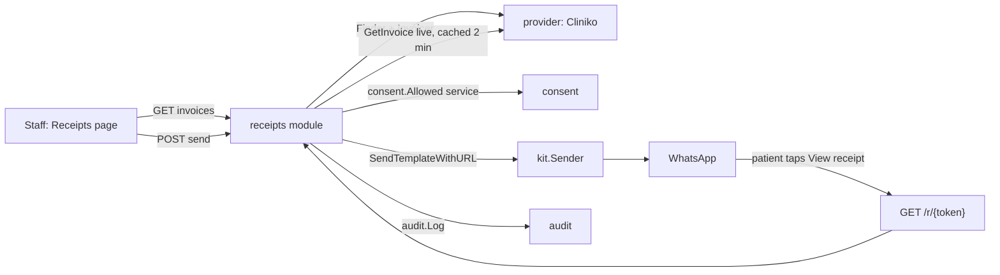
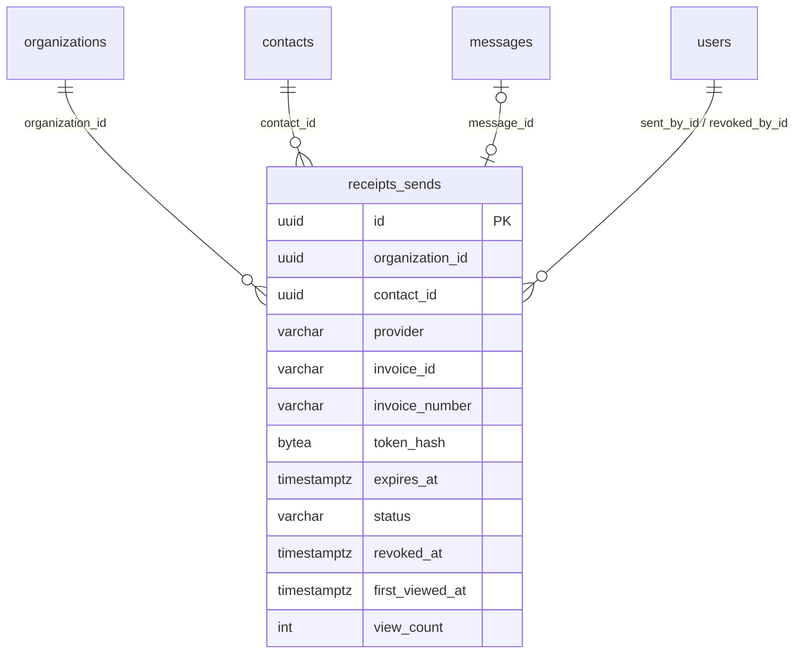

# Receipts: design

Spec: [`requirements.md`](requirements.md). API: [`api.md`](api.md). Links: [ADR-006](../../adr/ADR-006-secure-patient-links.md).
Code (to come): `internal/modules/receipts/`, `frontend/src/modules/receipts/`.

## Shape



- The module is a `provider.Consumer` (like timeline and reminders). It finds the patient with `provider.Finder` and
  reads invoices through a new optional ability:

```go
// Invoicer is an optional ability: reading a customer's invoices (Cliniko has it).
type Invoicer interface {
    ListInvoices(ctx context.Context, customerID string, since time.Time) ([]Invoice, error) // newest first, no items
    GetInvoice(ctx context.Context, id string) (*Invoice, error)                             // with items; ErrNotFound if deleted or archived
}

type Invoice struct {
    ID, Number, CustomerID   string
    IssueDate                string // YYYY-MM-DD, the clinic's date
    Status                   string // open | paid | closed | credit
    Currency                 string // "AUD"
    Total, Tax, Discount     int64  // cents
    PractitionerName         string
    BusinessName             string
    PaymentURL               string // "" when none or not open
    Items                    []InvoiceItem
}
type InvoiceItem struct { Name string; Quantity string; Amount int64 }
```

- **Cliniko:** `GET /patients/{id}/invoices` is deprecated, so `ListInvoices` uses `GET /invoices?q[]=patient_id:={id}`
  with `q[]=issue_date:>={since}` and `sort=issue_date&order=desc` (filter names to confirm in the trial);
  `GetInvoice` reads `/invoices/{id}` and `/invoices/{id}/invoice_items`. Status 10/20/30/40 → open/paid/closed/credit.
  Amounts are decimal strings, converted to cents without floats. `online_payment_url` becomes `PaymentURL` only when
  open. Archived or deleted invoices are `ErrNotFound`. Practitioner name from the linked practitioner (one more call,
  cached with the practitioner list the connector already keeps).
- **Sender:** `kit.Sender` gets `SendTemplateWithURL(ctx, orgID, contactID, name, lang, params, urlParams map[string]string)`,
  passing `urlParams` as upstream's `ButtonURLParams` (button index → value). `SendTemplate` stays as it is.
- **Contact search** reuses `timeline.Service.Search` (masked numbers, same rules) instead of a copy.

## Data model

One table. No invoice contents: the page reads them live.

| Table | Columns | Notes |
| --- | --- | --- |
| `wl.receipts_sends` | `id` uuid PK, `organization_id` uuid, `contact_id` uuid (→ `contacts.id`), `provider` varchar(30), `invoice_id` varchar(64) (the provider's id), `invoice_number` varchar(50), `token_hash` bytea (SHA-256, 32 bytes), `expires_at` timestamptz, `status` varchar(10) (`sent`, `failed`), `reason` varchar(60), `message_id` uuid null (→ `messages.id`), `sent_by_id` uuid (→ `users.id`), `revoked_at` timestamptz null, `revoked_by_id` uuid null (→ `users.id`), `first_viewed_at` timestamptz null, `view_count` int default 0, `created_at` timestamptz | `UNIQUE (token_hash)`; index `(organization_id, created_at DESC)`; index `(organization_id, contact_id)`; check on `status`; `expired` and `revoked` are derived for display |

Links to upstream tables by id only (contacts, messages, users), never by new columns. Permission `wl_receipts_sends`
seeded by the migration for admin, manager and agent (R9).

**Retention:** rows are send records (who was sent which invoice number, when): kept 7 years like booking history
(same question as booking Q10). `token_hash` is cleared 90 days after expiry by a nightly job, so even a stolen
database can't be matched against old links.



## Sending (R2)

1. Load the contact in the org (404 otherwise); find the customer (`Finder`); `GetInvoice` and check it belongs to that
   customer (409 "this invoice isn't this patient's" otherwise, so a wrong id can't leak another patient's receipt).
2. `consent.Allowed(…, PurposeService)`; refused → 409 with the reason, nothing stored.
3. Generate the token (`crypto/rand`, 32 bytes, base64url), insert the row with its hash and `status = sent`.
4. `SendTemplateWithURL` with body `{{1}}` clinic name, `{{2}}` invoice number, URL button `{{1}}` the token. Failure →
   row updated to `failed` with a reason (`template_missing`, `not_approved`, `send_error`), 502 to the caller.
5. `audit.Log` `receipt_sent` with the send id.

**Template** (one per organization's WhatsApp account, utility, English; installed with the clinic pack and submitted to
Meta during onboarding):

```text
Name: weline_receipt   Category: UTILITY   Language: en
Body:   Hi, your receipt {{2}} from {{1}} is ready. Tap below to view it.
Button: URL "View receipt" → {WELINE_PUBLIC_URL}/r/{{1}}
```

The URL's host is fixed when Meta approves the template, so each deployment (staging, production) has its own. Whether
Meta accepts `/r/#{{1}}` (a fragment the server never sees, ADR-006) is checked when submitting; if it does, the page
reads the token from the fragment with a few lines of script and the no-script fallback is lost. Default: path.

## Receipt page (R3, R4, R8)

Served by the module outside `/api` (upstream's auth covers `/api`), registered before the SPA catch-all, like
`/book/{slug}`: `GET /r/{token}`. One embedded Go `html/template`, inline CSS, no script.

1. Rate limit (upstream `middleware.RateLimit`): 30 a minute per IP.
2. Token shape check (43 base64url characters) → hash → row by `token_hash`. Missing, revoked or expired → the same
   "expired" page, status 404.
3. `GetInvoice` through the org's provider, cached in Redis for 2 minutes under the send id (encrypted with Weline's
   key, since it holds patient data). Down → "try again later", 503. Not found → "expired".
4. Render. Set `view_count = view_count + 1`, `first_viewed_at` if null, `audit.Log` `receipt_viewed` (system actor).
5. Headers on every response: `Cache-Control: no-store`, `Referrer-Policy: no-referrer`, `X-Robots-Tag: noindex`,
   `Content-Security-Policy: default-src 'none'; style-src 'unsafe-inline'; img-src 'self'; frame-ancestors 'none'`.
   "Pay now" is a plain link with `rel="noopener noreferrer"` to the provider's URL, shown only when it's an `https`
   URL on the provider's own host (`*.cliniko.com`).

## Screens (Vue, `frontend/src/modules/receipts/`)

Nav: under Contacts, "Receipts" (`wl_receipts_sends` read). Route `/x/receipts` with `?contact=<id>` so the timeline page
can link here.

- **Send tab:** search a contact (timeline's search) → their invoices (number, date, practitioner, total, status) →
  "Send on WhatsApp" with a confirm showing the masked number. States: loading, empty ("no invoices in the last 12
  months"), error, "connected system doesn't share invoices", "connected system unavailable", forbidden.
- **Sent tab:** the list (R5), filter by contact, "Cancel link" (needs delete) with a confirm. States: loading, empty,
  error, forbidden.

## Threats

New entry points, data and integrations, and how each is protected. Folded into
[`../../threat-model.md`](../../threat-model.md) by prompt C.

| Threat | Protection |
| --- | --- |
| **Public page (new, unauthenticated): guessing links** | 256-bit random tokens; only hashes stored; rate limit per IP; same response for unknown, expired and revoked. |
| **Forwarded message or shared phone** shows someone's receipt | Expiry (30 days), staff revoke, no PDF to keep. **Open risk** for receipts (accepted, Q2); clinical documents would need a second check (ADR-006 point 6). |
| **Tokens in request logs** (Render keeps paths) | Expiry, revocation, hash-only storage, log access limited to operators. **Open risk:** test the URL fragment with Meta. |
| **Sending the wrong patient's invoice** | Invoice must belong to the customer found for the contact (409 otherwise); confirm dialog shows the masked number; revoke. |
| **Cross-organization access** | Staff routes behind `kit.Guard`; every query filters by `orgID`; the page resolves the org only from the send row and reads through that org's provider. Tested with a second organization. |
| **New data: invoices (services received, amounts)** | Not stored; cached 2 minutes encrypted; never logged. Stored: invoice number and send facts only. |
| **Cliniko key use and rate limit** | Reads only through the existing connector (encrypted key, never returned); short cache; page views are few (one patient per link). Rate limited per IP. |
| **Malicious "Pay now" URL** (if a provider returned something odd) | Only `https` links on the provider's host are shown; `noopener noreferrer`. |
| **Caching and embedding** by browsers, proxies or other sites | `no-store`, `noindex`, `no-referrer`, CSP with `frame-ancestors 'none'`. |
| **Spam or misuse of sending** | Needs `wl_receipts_sends:create`; consent checked; each send audited with the sender. |
