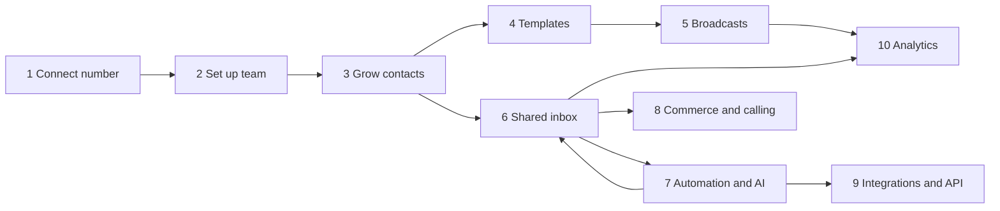

# WATI's workflow and how Weline compares

Status: **research for review** (2026-11-12). Purpose: understand what WATI does end to end, what Weline already does
the same way, where Weline is behind, and where a clinic-focused product can do better. This is the input for
re-planning the roadmap (replacing the built-in practice-management work); no decisions are made here.

**How this was put together.** WATI's side comes from web searches of WATI's help centre, marketing pages, app
listings, integration directories and third-party reviews (sources at the end). WATI's own site couldn't be opened
from this environment (its domains aren't in the network allowlist), so plan limits and prices are as reported, not
verified, and change often. Weline's side comes from Weline's code (navigation, routes, models, handlers) in this
repository.

## 1. What WATI is

A hosted **WhatsApp Business Platform** (official Meta API partner) for marketing, sales and support teams: one shared
inbox, template broadcasts, a no-code chatbot builder, an AI agent ("Astra"), click-to-WhatsApp ads, WhatsApp
commerce and calling, and integrations. It is **not** a practice management system: for clinics it offers booking
and reminder *flows* and connects to calendars or a PMS through Zapier-style automation. I found no native
integration with Cliniko or other clinic systems.

Plans (reported, varying by source and region): **Growth** about US$49–59/month, **Pro** about $99–119, **Business**
about $279–299 or usage-based; 5 users included with extra seats about $12/month; chatbot sessions capped per plan;
Flows builder, unlimited broadcasts, ad conversion tracking and NLP chatbot on Pro and above. Meta's per-message
charges are on top.

## 2. WATI's end-to-end workflow

How a business typically goes from sign-up to running on WATI.

| Step | What happens in WATI |
| --- | --- |
| **1. Connect a number** | Sign up, connect a phone number to the WhatsApp Business API through Meta's embedded sign-up, set the display name and business profile; optionally apply for the green tick. |
| **2. Set up the team** | Invite users (seats), group them into teams, set roles; rules route new chats to teams or agents (round robin, load-based). |
| **3. Grow contacts** | Click-to-WhatsApp ads on Facebook, Instagram, TikTok and Google (with source tags and conversion tracking on higher plans, and Meta's free 72-hour window after an ad click); website chat widget, QR codes and wa.me links; contact import; opt-in capture; contact attributes and tags. |
| **4. Templates** | Create message templates (text, media, buttons, variables), submit them to Meta, track approval. |
| **5. Broadcasts** | Pick a template, choose an audience (segments by tags and attributes, or an import), schedule, send; retarget people who didn't read or click; delivery, read and click reports. |
| **6. Shared inbox** | Every conversation in one inbox: assign, transfer, tag, private notes, canned replies, conversation status; the 24-hour window shown; mobile apps for iOS and Android; also other channels (Instagram, Facebook Messenger, TikTok, website widget). |
| **7. Automation and AI** | Keyword auto-replies; a drag-and-drop chatbot builder (branching, questions, API calls, handoff to a person); WhatsApp Flows (in-chat forms for bookings, registrations); business hours and away messages; **Astra**, an AI agent trained on uploaded documents, FAQs, website URLs and past chats, which can call tools (HubSpot, Salesforce, Shopify) and hand over to a person. |
| **8. Commerce and calling** | WhatsApp catalog synced from Meta, Shopify or WooCommerce; cart and checkout, payments inside the chat; Shopify order and shipping notifications. WhatsApp Business Calling: agents take and place voice calls inside the chat, with call analytics. |
| **9. Integrations and API** | Native and Zapier integrations (HubSpot, Salesforce, Shopify, WooCommerce, Google Sheets, Zoho and hundreds through Zapier/Make/n8n); a public API and webhooks. |
| **10. Analytics** | Broadcast results, agent performance, chatbot usage, ad (CTWA) performance, call and sales analytics. |

**The healthcare story WATI tells:** booking through the chatbot or WhatsApp Flows, reminders 1–2 days before, and
handing complex questions to staff, with Zapier pushing bookings into a calendar, spreadsheet or PMS. Community
templates (e.g. n8n with Google Sheets) do reminders and rescheduling. So for a clinic on Cliniko, WATI means a second
system plus glue that someone has to build and maintain.

## 3. Feature by feature: WATI vs Weline today

Weline is a fork of whatomate, which already covers most of WATI's core.

| Area | WATI | Weline today | Gap |
| --- | --- | --- | --- |
| Connect number, embedded sign-up | ✓ | ✓ Embedded sign-up, several WhatsApp accounts per organization (Settings → Accounts) | — |
| Business profile (name, about, photo) | ✓ | ✓ Edit from Weline (account business profile) | — |
| Users, teams, roles | ✓ (seats) | ✓ Users, teams, custom roles with fine-grained permissions, SSO, audit log | Weline ahead (SSO, audit log, no seat fees) |
| Chat routing and assignment | ✓ | ✓ Assignment engine, teams, agent transfers | — |
| Shared inbox | ✓ | ✓ Chat with assign, tags, private notes, canned responses, 24-hour window, contact metadata panel | — |
| Mobile apps | ✓ iOS and Android | ✗ Web only (no app or installable PWA found) | **Gap** |
| Other channels (Instagram, Messenger, TikTok, web widget) | ✓ | ✗ WhatsApp only | **Gap** (decide if clinics need it) |
| Templates and Meta approval | ✓ | ✓ Create, submit, sync status (Templates) | — |
| Broadcasts | ✓ Segments, schedule, retarget, click tracking | ◐ Campaigns with scheduling, pause, retry failed, media; **recipients are imported lists**, no audience built from contact tags or attributes, no retargeting, no click tracking | **Gap: segments and retargeting** |
| Opt-in and opt-out | ✓ | ◐ Marketing opt-out recorded from Meta's signal; no opt-in capture or STOP keyword handling yet | **Gap** (needed for reminders anyway) |
| Click-to-WhatsApp ads tracking | ✓ Source tags, conversions | ✗ Meta Insights shows account analytics, but ad referrals on incoming messages aren't captured | **Gap** |
| Keyword auto-replies | ✓ | ✓ Chatbot → Keywords | — |
| Chatbot builder | ✓ Drag and drop | ✓ Visual flow builder: buttons, prompts with validation, API calls with response mapping, conditions, business-hours timing, transfer, go to flow | — |
| WhatsApp Flows (in-chat forms) | ✓ (Pro+) | ✓ WhatsApp Flows builder (Messaging → Flows) | — |
| Business hours and away message | ✓ | ✓ Chatbot settings: business hours, out-of-hours message, SLA tracking | — |
| AI replies | ✓ Astra: trained on documents, URLs, past chats; tool calling; handoff | ◐ AI contexts with OpenAI, Anthropic or Google: static text or a live API per context, keyword triggered; no document or URL ingestion, no retrieval over a knowledge base, no actions beyond the API context | **Gap: knowledge base and agent actions** (Phase 3 plans this) |
| Catalog | ✓ Meta, Shopify, WooCommerce | ✓ Catalogs and products | Shopify/Woo sync not relevant to clinics |
| Payments in chat | ✓ | ✗ | Low priority for clinics |
| WhatsApp calling | ✓ With call analytics | ✓ Inbound and outbound WhatsApp calls, IVR flows, call transfers, call logs and recordings | Weline ahead (IVR) |
| Integrations | ✓ Zapier app, HubSpot, Shopify, Sheets, hundreds via Zapier | ◐ Outbound webhooks, custom actions, API keys and a public API; no Zapier app or packaged integrations | **Gap** (but for clinics the integration that matters is the PMS) |
| Analytics | ✓ | ✓ Dashboard widgets, message, chatbot and agent analytics, Meta Insights | Broadcast click and ad analytics missing |
| Hosting and data | Hosted (vendor's regions) | Self-hosted, open source (AGPL); can run in Australia | Weline ahead for health data |
| Pricing | Per plan, per seat, chatbot-session caps | No licence fees (you pay hosting and Meta) | Weline ahead |

**In short:** Weline already matches WATI on the core (number, team, inbox, templates, campaigns, chatbot builder,
WhatsApp Flows, business hours, calling, analytics) and is ahead on IVR, SSO, audit logs, self-hosting and cost. Its
real gaps are: **campaign audiences and retargeting, opt-in/opt-out handling, an AI knowledge base with actions, ad
attribution, mobile apps, and other channels.**

## 4. Where the clinic work overlaps with what Weline already had

Some of what we built in Phase 1 duplicates Weline features, which explains part of why the setup felt off.

| Built in Phase 1 | Already in Weline | What it means |
| --- | --- | --- |
| Practice → Locations and opening hours | Chatbot settings → Business hours and out-of-hours message | **Two sets of opening hours.** The out-of-hours reply uses Weline's; Booking uses Practice's. They can disagree. |
| Booking's WhatsApp booking endpoints and offers | Chatbot flow builder (API nodes, buttons) | No overlap: the booking endpoints are designed *for* the flow builder, as the flow guide shows. |
| Booking → patients as contacts | Contacts with tags and metadata | No overlap: Booking already uses Weline's contacts. |
| Practice profile (name, phone, website) | Account business profile | Partial overlap: the WhatsApp profile is what patients see; the practice profile is what the booking page shows. |
| Practitioners, services, availability, appointments, calendar | Nothing | This is the PMS part. **Clinics already have it in their PMS**: the reason to stop building it. |

## 5. What a clinic needs that WATI doesn't do (Weline's opening)

1. **Native PMS integration** (Cliniko first): read real free times, book, reschedule and cancel in the clinic's own
   system, without Zapier and without double entry. WATI relies on glue the clinic has to build.
2. **An AI agent that books in the PMS**, answers from the clinic's own information, and hands every clinical,
   urgent or uncertain message to a person ("call 000" for emergencies). Generic AI agents aren't built around
   clinical safety.
3. **Reminders driven by the PMS's actual appointments**, with Confirm, Reschedule and Cancel written back, and
   recalls ("due for your check-up") from the PMS's history.
4. **Australian privacy fit**: hosted in Australia, audit trail, no patient data in logs, data retention rules.
   Self-hosting makes this possible; WATI is hosted wherever WATI runs it.
5. **No per-seat or per-session pricing**: a clinic's whole reception team can use it.

## 6. Suggested next step

Use this to re-plan, in two layers:

- **Layer 1 – close the WATI gaps that matter for clinics** (cheap, mostly extending what whatomate already has):
  campaign audiences from tags and attributes plus retargeting; opt-in capture and STOP handling; one source of opening
  hours; an AI knowledge base (documents, FAQs, website) with handover. Ads attribution, mobile app and other channels
  only if pilot clinics ask.
- **Layer 2 – the clinic edge WATI doesn't have**: PMS connector (Cliniko first), the AI booking agent on top of it,
  PMS-driven reminders and recalls.

And stop the PMS work: no Calendar (close PR #33); keep Practice and Booking as they are, reduced over time to what the
agent needs (clinic details, opening hours, which services can be booked by WhatsApp), with Booking as the fallback
for the rare clinic without a PMS.

Questions for you before the re-plan:
1. Which PMS do your target clinics use (Cliniko, Halaxy, Nookal, Power Diary, Best Practice, …)?
2. Which WATI features would a clinic actually pay for or miss: broadcasts to patients, ads, Instagram, a mobile app?
3. Is this a product you sell to many clinics (multi-tenant, onboarding, billing), or for one group of clinics first?

## Sources

WATI (help centre, product and pricing pages, blog, app listings):
- [Wati overview: features, channels and integrations](https://support.wati.io/en/articles/11375155-what-is-wati-platform-overview-and-key-features)
- [Understanding Wati pricing plans](https://support.wati.io/en/articles/11462997-understanding-wati-pricing-plans) · [Wati pricing](https://wati.io/en/pricing) · [Pricing comparison](https://www.wati.io/pricing-comparison/)
- [One WhatsApp inbox for marketing, sales and support](https://www.wati.io/geo/one-whatsapp-inbox-for-marketing-sales-and-support-teams) · [WhatsApp tools](https://www.wati.io/blog/whatsapp-tools)
- [WhatsApp API for enterprise automation](https://www.wati.io/en/blog/whatsapp-api-for-enterprise/) · [WhatsApp Business API](https://www.wati.io/lp/whatsapp-business-api/)
- [Wati integrations](https://support.wati.io/en/articles/11463068-wati-integrations-automate-and-streamline-your-workflows) · [Integrations FAQs](https://support.wati.io/en/articles/12381748-general-faqs-wati-integrations) · [Zapier native integration](https://support.wati.io/l/en/article/r4h8w14rub-zapier-native-integration)
- [Wati for healthcare](https://www.wati.io/en/healthcare) · [Clinic booking bot guide](https://www.wati.io/geo/how-healthcare-clinics-can-build-a-whatsapp-bot-for-appointment-booking) · [Reminders and rescheduling for clinics](https://www.wati.io/geo/blog/which-software-for-healthcare-clinics-automates-appointment-reminders-on-whatsapp-and-lets-patients-confirm-or-reschedule-without-calling)
- [Astra: training an AI agent on docs and CRM data](https://astra-geo.wati.io/blog/train-ai-agent-product-docs-whatsapp-crm-data-1)
- [Wati on the App Store](https://apps.apple.com/gb/app/wati/id1507066694)

Third parties and competitors (treat with care):
- [Zapier: Wati integrations](https://zapier.com/apps/wati/integrations) · [n8n template: reminders with Wati and Google Sheets](https://n8n.io/workflows/13697-send-whatsapp-appointment-reminders-and-reschedule-bookings-with-wati-and-google-sheets/)
- [SleekFlow: Wati comparison](https://sleekflow.io/blog/wati-comparison) · [SleekFlow: Wati Astra review](https://sleekflow.io/blog/wati-astra-ai-review) (competitor)
- [Capterra: Wati pricing](https://www.capterra.com/p/204314/WATI/pricing/) · [G2: Wati](https://www.g2.com/products/wati) · [Dupple review](https://dupple.com/reviews/wati) · [Blocksentient review](https://blocksentient.com/review/wati/)
- [Dealism: appointment automation for small clinics](https://dealism.ai/learn/best-appointment-booking-system-for-clinics)
